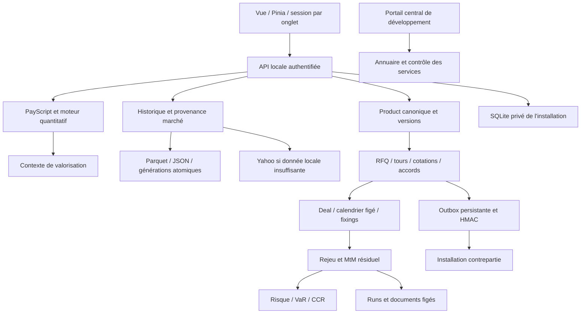

# Structura — rapport fonctionnel, financier et technique pour revue indépendante

**Photographie du code local au 24 octobre 2026 — Europe/Berlin.**

**Objet :** décrire l'application et ses mécanismes avec suffisamment de précision pour permettre à une autre IA, puis à un reviewer humain, d'en examiner la cohérence métier, quantitative et opérationnelle.

**Référence Git :** branche `codex/hybrid-saas-foundation`, HEAD `7dce3021a88feb4f0021ca3de8f3596277bc72a5`, avec un volume important de modifications locales. Le HEAD ne désigne donc pas à lui seul l'application décrite. Les empreintes des fichiers de cette inspection sont dans `application-review-2026-10-24/SOURCE_MANIFEST.json`.

**Nature de la revue initiale, avant la phase de correction :** inspection statique du dépôt, lecture détaillée des chemins critiques, inventaire structurel des sources et confrontation avec les preuves documentaires existantes. Aucun nouveau pricing, pytest, build, téléchargement de marché, démarrage de service ou parcours navigateur n'a été exécuté. Aucune base métier ni aucun fichier de secrets n'a été ouvert. Les résultats de recettes antérieures sont datés et attribués à leurs rapports, jamais présentés comme des exécutions de cette revue.

**Limite de couverture :** l'inventaire est systématique sur les fichiers retenus ; la lecture humaine du code est approfondie par domaine et par chemin critique. Il ne s'agit pas d'une démonstration ligne par ligne des quelque 155 000 lignes applicatives, ni d'un audit de sécurité exhaustif, ni d'une certification quantitative ou réglementaire. Les annexes distinguent inventaire automatique et analyse sémantique. Cette distinction est nécessaire pour que l'IA destinataire ne transforme pas ce rapport en preuve universelle de validité.

## Actualisation après corrections CR01-CR04 - première phase

**Édition actualisée du 24/10/2026.** Les quatre défauts établis par la contre-revue livrée sont corrigés : contexte KID/MTF transmis ou explicitement refusé, convergence du solveur au paramètre publié, levier EMT indépendant de sa notation et créances KID conservées après STOP. Les sections 12.5-12.6, 31.3 et 32, ainsi que R02-R04, sont actualisées ci-dessous. Les catégories et identifiants de la contre-revue sont propres à `report/COUNTER_REVIEW_FR.md`.

Les preuves jointes couvrent **118 cas ciblés distincts**, dont 50 cas de régression. Elles ont été exécutées pendant la phase de correction et sont relues sans nouvelle exécution pour cette édition. Les autres chapitres, inventaires initiaux et scénarios V01-V90 conservent leur portée historique ou proposée : aucun taux de couverture général n'en est déduit. Le manifeste initial identifie l'état avant correction ; `evidence/post-correction/SOURCE_MANIFEST_AFTER_FIXES.json` et les sources embarquées identifient l'état corrigé.

Les 44 chapitres restent présents. Le rapport complet de contre-revue, sa carte de validité et son annexe 4 précisent les statuts, les restrictions restantes et les journaux JUnit. Le KID/EMT reste indicatif ; le modèle outer GBM, la grille hebdomadaire, la méthodologie VEV et les autres limites ne sont pas qualifiés par cette correction. Aucun test n'est relancé lors de cette actualisation ; aucun commit ni push n'est effectué.

## Actualisation après la seconde confrontation

Les quatre nouvelles corrections SC01-SC04 sont intégrées : contrôle des observations non futures des calendriers nommés, figés et du moteur ; message distinguant échéance et règlement bancaire ; seed MTF 42 en lecture seule avec requêtes cohérentes ; retrait de l'alias scalaire ee des nouvelles sorties CCR. Les sections 7, 12.5, 18.5 et 23.5 sont actualisées. Les 31 constats CR initiaux gardent leur identité ; CR05 est maintenant corrigé.

Les preuves conservées portent sur **285 tests backend réussis**, dont 19 nouvelles régressions et les 50 régressions de la première phase ; **782 tests frontend réussis**, dont trois nouveaux cas MTF ; compilation réussie en sortie isolée. Les 118 cas antérieurs ne sont pas additionnés aux 285 comme validations indépendantes. L'annexe 5 de la contre-revue et evidence/post-followup/ distinguent les preuves finales et les itérations intermédiaires.

Le défaut de dates non futures est fermé ; l'approximation de grille demeure. Le message de règlement est corrigé ; le suivi bancaire des impayés demeure hors périmètre. KID/EMT indicatifs, restrictions MTF, modèles, données, VaR/CCR, gouvernance et exploitation conservent leurs limites. Les sources actuelles sont identifiées par SOURCE_MANIFEST_AFTER_FOLLOWUP.json ; les inventaires précédents restent historiques. Cette régénération ne lance aucun test, build ou import applicatif, ni commit ni push.

## Mode d'emploi du dossier

1. Lire ce rapport pour comprendre les objets, les calculs, les workflows et leurs limites.
2. Lire `application-review-2026-10-24/ANNEXES.md` pour les inventaires et les points d'entrée exacts.
3. Utiliser `REVIEW_PROMPT.md` pour lancer une contre-revue exigeant preuves, contre-exemples et niveaux de certitude.
4. Consulter les fichiers JSON pour rechercher une route, une classe, un champ, une fonction ou un test précis.
5. Pour valider un résultat, demander les sources et les données synthétiques nécessaires. Ce rapport décrit des mécanismes ; il ne remplace pas leur reproduction indépendante.

Dans les références de domaine, les chemins abrégés `core/`, `api/`, `services/`, `db/` et `hybrid/` sont relatifs à `backend/app/`. Les annexes donnent les chemins complets relatifs au dépôt et les numéros de ligne de cette photographie.

## Sommaire

- 1–4 : identité de l'application, périmètre, architecture et accès.
- 5–8 : objets métier, conventions, calendriers et PayScript.
- 9–13 : moteur quantitatif, marchés, Pricer, analyses et Optimizer.
- 14–20 : RFQ, exécution, booking, fixings, MtM, archives et Valo Explain.
- 21–25 : risque, VaR, CCR, trading et réinvestissement.
- 26–30 : CRM, import commercial, AMC, FIFO et scores d'étude.
- 31–38 : KID, EMT, documents, IA, simulation, calculs, administration et exploitation.
- 39–44 : preuves, constats, décisions ouvertes, plan de validation et glossaire.

## 1. Ce que fait réellement Structura

Structura est une application de desk pour concevoir, valoriser, commercialiser, enregistrer et suivre des produits structurés. Elle associe un langage de payoff, un moteur Monte Carlo, un dossier produit versionné, un réseau de demandes de prix, un book de transactions, des analyses de risque, un CRM et un atelier d'études AMC.

Sa logique principale est : **définition contractuelle → calcul indicatif → RFQ et cotations → accord de traitement → booking local → observations et événements → valorisation résiduelle → risque, explication et documents**.

L'application ne se réduit donc pas à un pricer. Elle conserve aussi les conditions négociées, les responsabilités des desks, les versions de termes, les fixings, des preuves de calcul et des rapprochements entre installations. Plusieurs modules sont des outils d'analyse ou de préparation documentaire, dont la sortie ne vaut pas décision réglementaire, ordre de marché ou preuve de paiement.

Les consignes fournies dans le contexte mentionnent INDEX_STUDIO. Le dépôt effectivement inspecté, son `CLAUDE.md`, son backend et son frontend correspondent à **Structura**. Aucun moteur institutionnel dédié de construction d'indices QIS ni module générique de « robustness scoring » INDEX_STUDIO n'a été identifié dans ce périmètre. Les études AMC, les grilles de paramètres, les stress et l'Optimizer ne doivent pas être renommés en un tel moteur.

### 1.1 Les grands métiers servis

| Domaine | Service rendu | Sortie principale | Limite à préserver |
|---|---|---|---|
| Structuration | Écrire et paramétrer un payoff | Script, termes, calendrier | Syntaxe valide ≠ bon contrat |
| Pricing | Calculer une valeur sous hypothèses explicites | Prix, IC, flux, Greeks | Prix modèle ≠ cotation exécutable |
| Analyses | Comprendre scénarios, probabilités et historique | Graphiques et distributions | Probabilités Q ≠ prévisions |
| Optimizer | Explorer une grille de produits admissibles | Candidats et validation statistique | Grille finie ≠ optimum global |
| RFQ | Solliciter et comparer des fournisseurs | Tours et cotations versionnés | Réception technique ≠ accord de traitement |
| Exécution | Demander et confirmer une offre précise | Accord et preuves authentifiées | Confirmation ≠ booking des deux livres |
| Booking | Inscrire un contrat exécuté | Deal et snapshots | Données figées, droits et contrôles requis |
| Lifecycle | Déterminer coupons, rappel et remboursement | Fixings, propositions, résolutions | Observation ≠ paiement confirmé |
| Valorisation | Rejouer le passé et valoriser le reliquat | MtM daté, contexte et run | Contrat neuf ≠ contrat en vie |
| Risque | Agréger sensibilités et expositions | Greeks, stress, VaR/ES, CCR | Couverture et domaines bornés |
| CRM | Relier clients, contacts, mandats et transactions | Dossiers et signaux commerciaux | Observation descriptive ≠ causalité |
| AMC/FIFO | Analyser NAV, carnet et gestion active | Études, attribution, scores et PDF | Reconstruction et proxies à qualifier |
| Documentation | Préparer KID, EMT et notes de valorisation | Analyses, brouillons, archives | Pas de conformité générale démontrée |
| Administration | Gérer identités, référentiels et calculs | Paramétrages et audits | Admin technique et métier distincts |
| Simulation | Exercer les parcours sur installations isolées | Campagnes et preuves | Une campagne ne certifie pas toute l'application |

### 1.2 Volumétrie statique

L'extraction a parsé **512 fichiers Python**, sans erreur de syntaxe AST sur le périmètre retenu. Elle identifie **266 fichiers Python applicatifs**, soit **88 780 lignes**, et **316 fichiers Vue/JavaScript frontend**, soit **66 097 lignes**, tests frontend compris. Les comptages portent sur les lignes physiques, commentaires et lignes vides inclus.

Les inventaires identifient **187 fichiers de tests backend** et **2 545 définitions de tests** avant expansion des paramétrisations, ainsi que **86 fichiers frontend `*.test.js`**. Ces définitions ne sont ni un nombre d'exécutions, ni une mesure de couverture.

L'extraction identifie **458 déclarations de routes**, fabriques imbriquées et `api_route` génériques compris. Ce nombre n'est pas celui des URL uniques d'un serveur : alias, montages, fabriques centrales et environnement choisi modifient l'ensemble exposé. Les méthodes et préfixes figurent dans les annexes ; l'extraction n'exécute pas l'assemblage FastAPI.

## 2. Carte des écrans et des workflows

Le frontend est une SPA Vue avec routage par fragment d'URL (`createWebHashHistory`). Les liens métiers sont partageables dans le contexte de l'installation et soumis à la session courante.

| Écran ou famille | Route principale | Contenu |
|---|---|---|
| Accueil | `/` | Entrées par métier, dossiers et activité récente |
| Connexion | `/login` | Identité d'installation, compte et accès de développement conditionnels |
| Sécurité | `/account/security` | Mot de passe et gestion des sessions |
| Bibliothèque | `/scripts` | Scripts, dossiers, paramètres et configurations |
| Modèles | `/product-models` | 19 fiches de produits génériques |
| Pricer | `/pricer`, `/pricer/:id` | Éditeur, Economics, marché et résultats |
| Produit | `/products`, `/products/:productId/pricer` | Dossiers canoniques et réouverture |
| Déclinaison | `/pricer/v/:variantId` | Variante identifiée et comparaison |
| Structuring Intelligence | `/structuring` | Point d'entrée des recherches de structuration |
| Optimizer | `/structuring/optimizer` | Objectifs, marché, axes et contraintes |
| Recherches | `/structuring/researches` | Recherches conservées et résultats |
| RFQ demandeur | `/rfq` | Préparation, envoi, prix, choix et traitement |
| RFQ banque | `/rfq/recues` | Prise en charge, calcul privé, publication et décision |
| Analyse fournisseurs | `/rfq/analyse` | Historique de compétition et comparaisons |
| Revue de booking | `/rfq/:rfqId/booking` | Revue opérationnelle du dossier retenu |
| Booking | `/booking` | Deals, calendriers, fixings, événements, MtM et actions |
| Historique MtM | `/booking/:dealId/valuations` | Runs de valorisation archivés |
| Valo Explain | `/valo-explain` | Notes fondées sur un ou deux runs sélectionnés |
| Risque | `/risk` | Agrégats, barrières, stress, VaR et P&L |
| Contrepartie | `/risk/ccr` | Référentiels juridiques, expositions et limites |
| Réinvestissement | `/reinvest` | Comparaison de maintien, variantes et nouvelle note |
| Trading | `/trading` | Relations de distribution, exécutions et positions en notes |
| AMC | `/amc` | Import, manifeste, blocs d'étude et export |
| FIFO | `/fifo` | Reconstruction du carnet et diagnostics |
| Clients | `/clients/...` | Liste, contacts, opportunités, signaux, analytics, import |
| Fiches | `/clients/fiche/:id/:section?` | Dossier client par section |
| Contact | `/clients/contacts/:id` | Personne, affiliations et couverture |
| Opportunité | `/clients/opportunites/:id` | Chaîne commerciale et rattachements |
| Administration | `/admin/...` | Utilisateurs, entités, données, desks, relations, files et UAT |
| Console centrale | `/platform` | Annuaire et services de développement |
| Atelier | `/agent-workshop` | Campagnes de simulation et consultation des books |
| Consultation | `/consultation` | Ouverture protégée d'un book archivé |
| Documentation | `/documentation` | Aide intégrée |

Le routeur contrôle notamment l'authentification, le changement obligatoire du mot de passe, les capacités de pricing et de booking, l'administration centrale et technique. Cela améliore le workflow ; l'autorisation effective reste une responsabilité du backend. Le routeur avertit aussi lorsqu'une déclinaison modifiée risque d'être perdue.

**Sources :** `frontend/src/router/index.js`, `frontend/src/views/`, `frontend/src/stores/auth.js`.

## 3. Architecture et circulation des données

### 3.1 Pile technique

- **Frontend :** Vue 3, Pinia, Vue Router, Chart.js, Tailwind/PostCSS ; Vite et Vitest pour compilation et tests.
- **API :** FastAPI, Pydantic 2, Uvicorn, endpoints synchrones pour les calculs CPU afin de ne pas bloquer directement la boucle événementielle.
- **Calculs :** NumPy, SciPy, pandas, statsmodels ; simulation et évaluation du DSL dans le backend.
- **Persistance :** SQLModel/SQLAlchemy sur SQLite, blobs JSON pour les contextes et snapshots ; Parquet/JSON pour les historiques et caches.
- **Documents :** ReportLab et Matplotlib pour les rapports ; openpyxl pour les classeurs.
- **Marché :** adaptateur Yahoo Finance par `yfinance`, facteurs Fama-French locaux, données et hypothèses manuelles.
- **IA :** adaptateurs HTTP pour Ollama, OpenAI et Anthropic selon la fonction ; transcription locale par faster-whisper.
- **Calculs en lot :** processus ou threads via une couche commune et file persistante.

Les versions déclarées sont dans `requirements.txt`, `requirements.lock.txt`, `frontend/package.json` et `frontend/package-lock.json`. Ce rapport ne vérifie pas les versions effectivement chargées dans une installation active ni leur sécurité vis-à-vis d'avis externes récents.

### 3.2 Schéma de principe



### 3.3 Démarrage et services automatiques

`backend/app/main.py` assemble les routeurs, initialise le schéma et lance, hors modes désactivés :

1. une reprise des recherches Optimizer interrompues ;
2. un passage lifecycle quotidien à 23 h dans le fuseau configuré par son service, avec reprise des passages manqués ;
3. une boucle de transport RFQ vérifiant les messages en attente environ toutes les deux secondes.

L'instance peut aussi servir le frontend compilé de `frontend/dist`. `index.html` est envoyé avec revalidation du cache pour éviter qu'un ancien HTML référence des bundles supprimés après un build.

Le démarrage sans environnement explicite dans `backend/run.py` ouvre aujourd'hui le launcher. Avec manifeste ou répertoire de données explicite, il sélectionne application métier, portail, contrôleur de simulation ou workspace Admin. Uvicorn écoute en loopback et garde `reload=False` dans ce chemin.

**Conséquence d'audit :** importer l'application ou lancer un serveur peut initialiser/migrer des données et démarrer des traitements. L'inventaire présent évite ces effets en lisant les fichiers et l'AST seulement.

### 3.4 Couplage et points de maintenance

La logique est répartie entre routes, cœur de domaine et services. Des éléments partagés ont été extraits récemment, notamment `deal_valuation.py`, `booking_contract.py`, `instance_signing.py` et `rfq_state.py`. Une part importante du workflow demeure néanmoins dans `api/deals.py`, qui atteint 7 899 lignes, et le moteur central 5 068 lignes. Cela augmente la charge de revue et la nécessité de tests d'intégration entre domaines.

## 4. Installations, acteurs et permissions

### 4.1 Modèle hybride effectivement présent

Le code du socle hybride prépare six installations métier distinctes : BNP Paribas, Société Générale, Citi, UBS, Leonteq et Kepler Cheuvreux Solutions. Il s'agit d'identités de développement configurées, pas d'une preuve que ces institutions sont clientes ou connectées en production.

Chaque installation métier possède son répertoire privé, sa base, son UUID d'installation, son UUID d'organisation et sa clé de signature. Le service central utilise une base distincte `platform.db`, un schéma propre et un annuaire autorisant seulement des métadonnées publiques d'installation.

Les manifestes actuels imposent `environment="DEVELOPMENT"`, `registry_state="NOT_CONFIGURED"` et `billing_enabled=false`. L'architecture ne doit donc pas être décrite comme un SaaS de production qualifié ni comme un registre central de facturation opérationnel.

### 4.2 Profils métier gérés

| Profil affiché | Rôle technique | Capacités de base |
|---|---|---|
| Super utilisateur | `organization_admin` | Lecture, préparation, pricing, sales, booking, préparation/validation opérationnelles, administration de l'organisation, gestion des relations et déclaration de règlement |
| Front | `user` | Lecture, préparation, pricing et sales |
| Opérations | `ops_maker` | Lecture, booking, préparation opérationnelle et déclaration de règlement |
| Contrôleur | `checker` | Lecture et validation opérationnelle |
| Admin technique | `admin` | Périmètre technique/autonome, distinct du compte métier géré |
| Admin central | `platform_admin` | Annuaire/contrôle central et délégations de simulation autorisées |

Les droits RFQ sont plus fins que cette table : organisation, desk pilote, appartenance active, partage de dossier, expiration et droit demandé se combinent. Posséder une capacité générale de pricing ne donne pas accès à tous les calculs bancaires privés.

Le mode autonome historique conserve certaines compatibilités, dont le booking Front et la visibilité étendue de l'admin technique. Elles ne doivent pas être extrapolées aux installations gérées. La politique de seconde signature des amendements est configurable et désactivée par défaut ; la machine demande/approbation/application reste obligatoire.

### 4.3 Authentification

Le backend utilise des mots de passe bcrypt et des JWT HS256 d'une durée de sept jours. Les jetons gérés portent émetteur, audience et organisation de l'installation. Un `jti` et une version de session permettent révocation individuelle et révocation de toutes les sessions d'un utilisateur.

À chaque contrôle, le serveur vérifie aussi activité du compte, version d'authentification, révocation et cohérence avec l'identité persistée de l'installation. Les mots de passe de remplacement doivent avoir au moins 12 caractères et au plus 72 octets UTF-8. La politique est fondée sur la longueur ; aucune exigence de complexité supplémentaire n'est déduite du code examiné.

Le login contient un freinage en mémoire par couple identifiant/IP : après cinq échecs, blocages gradués de 60, 300 et 900 secondes. Ce mécanisme ne survit pas à un redémarrage et ne constitue pas un rate limiter distribué.

Le frontend conserve le jeton dans `sessionStorage`, par onglet, et supprime l'ancien jeton partagé de `localStorage`. Un changement de session annule les requêtes suivies et invalide les réponses tardives. Le stockage reste accessible au JavaScript de l'origine : ce choix ne constitue pas à lui seul une protection contre le XSS.

### 4.4 Accès de développement et consultation

L'accès développeur exige une activation explicite, le loopback, une origine autorisée et un en-tête dédié. Le portail émet des tickets RS256 d'une minute à destination d'une installation et d'un profil précis ; la rédemption est persistée pour éviter les réutilisations. Ce chemin est un confort local de développement, pas un SSO de production démontré.

Le complément local du 24/10 permet depuis Admin de rejoindre le portail, choisir explicitement l'un des quatre profils et démarrer à la demande la seule organisation choisie avant émission du ticket. Un échec conserve la session courante et les liens de retour ; les saisies modifiées déclenchent leur garde. Le rapport de cette livraison précise qu'un portail déjà en mémoire doit être relancé par son utilisateur pour charger le nouveau serveur. Ce document décrit le code local ; il ne suppose pas ce redémarrage effectivement réalisé.

La consultation d'un book de simulation est protégée à plusieurs niveaux : endpoints de mutation/recalcul refusés, SQLite ouvert en lecture seule avec `PRAGMA query_only=ON`, verrou OS sur le dossier consulté et état de session conservé à côté du book. Cette consultation n'exécute pas de nouveaux ordres métiers.

**Sources :** `core/access.py:23`, `api/auth.py:102`, `core/session_security.py`, `services/business_access.py`, `services/rfq_access.py`, `hybrid/config.py`, `hybrid/business.py`, `hybrid/platform.py`, `hybrid/development.py`, `frontend/src/utils/session.js`.

## 5. Le modèle métier : Product, calcul, RFQ et Deal

### 5.1 Product : dossier commun

Le `Product` canonique est une structure Pydantic immuable. Les objets JSON imbriqués sont encodés puis reprojetés en copies fraîches, pour qu'un consommateur ne puisse modifier indirectement les calendriers d'un autre module.

Ses principales composantes sont :

| Bloc | Contenu | Autorité |
|---|---|---|
| Identité | ID, référence, nom, origine, visibilité et archive | Référentiel produit |
| Version | `revision`, `terms_version`, filiation | Révisions explicites |
| `terms` | Script, paramètres effectifs, identités des actifs, quatre dates, calendrier résolu | Définition contractuelle |
| `intent` | Nominal envisagé, sens, contrepartie, format et classification | Intention de transaction |
| `commercial` | Client, mandat, opportunité, affiliation | Chaîne commerciale |
| `indicatives` | Références d'indicatifs | Faits pré-trade conservés |
| `rfqs` | Projections des RFQ | Workflow RFQ |
| `execution` | Projection du booking | Deal exécuté |
| `lifecycle` | Projection des événements officiels | Registres lifecycle |
| `documents` | Liens et versions documentaires | Documents conservés |
| `calculations` | Références de calculs datés | Runs de calcul |

Un Product peut exister avant tout trade. Il peut être persisté pour un workflow sans apparaître dans « Mes produits » : `listed` et existence en base sont deux décisions distinctes. `data_origin` distingue `native`, `demo`, `uat` et `imported`.

### 5.2 Termes et hypothèses de marché séparés

Les termes décrivent ce qui sera observé et payé ; le contexte de calcul fournit marché, modèle, simulation, taux et funding. `product/inputs.py` compose les deux et remet les sous-jacents dans l'ordre contractuel. Il ne faut pas qu'une ancienne configuration locale remplace les termes d'un dossier chargé.

Une modification de terme crée une nouvelle version contractuelle. Une modification documentaire ou commerciale peut créer une révision de dossier sans nouvelle version de terme. Les appels attendent les versions/révisions pertinentes et refusent les modifications sur une base périmée.

### 5.3 Persistance et identité

Les tables principales sont `products`, `product_terms_versions`, `product_revisions`, `product_calculation_runs`, `product_commands` et `booking_commands`. Les commandes conservent clé et empreinte de contenu ; le même identifiant avec un contenu différent est un conflit.

Des contraintes et triggers SQLite renforcent les liens aux versions, les archives et l'unicité. Un index limite les nouveaux Deals à un par Product lié ; les forks de booking sont explicites. Les données historiques incomplètes ne sont pas assimilées silencieusement à des objets modernes qualifiés.

### 5.4 Deal : transaction effectivement bookée

Le Deal contient notamment Product/version exécutée, contrepartie juridique, sens, devise, nominal, fair value, prix traité, dates de trade/strike/valeur/maturité/paiement, script, sous-jacents, marché figé, calendrier figé, politique de fixing, statut, version contractuelle et liens RFQ/CRM.

Un `Indicative` conserve une proposition de travail, un `RfqRequest` une demande de prix, un `RfqQuote` une réponse et un `Deal` une inscription exécutée. Ces objets ont des finalités différentes ; créer un Deal pour représenter une simple exploration casserait la sémantique du book.

**Sources :** `core/product/models.py:64`, `core/product/models.py:185`, `core/product/inputs.py`, `services/product_repository.py`, `db/models.py:16`, `db/models.py:579`, `db/product_migrations.py`.

## 6. Conventions financières et unités

### 6.1 Les dates

| Date | Rôle |
|---|---|
| Trade | Date de l'accord/enregistrement de la transaction |
| Strike / StartDate | Fixing initial et origine du contrat |
| Valeur | Date d'échange du prix ; le PV peut y être rebasé |
| Observation | Date où une condition du payoff est évaluée |
| Maturité | Dernière observation contractuelle |
| Paiement | Date où un flux est dû, distincte de sa constatation |
| Valorisation | Coupe entre passé réalisé et futur simulé |

La convention d'année principale est `jours / 365.25`. La densité de diffusion est proche de 52 pas/an ; l'horizon est exactement celui demandé, avec `steps=max(1,round(T*52))`, `dt=T/steps`. Les occurrences sont ordonnées par temps contractuel, puis ordre source en cas de simultanéité. Plusieurs occurrences peuvent rester distinctes tout en lisant le même point de diffusion.

### 6.2 Prix, cash et sens

- `PAY 1` signifie un nominal, `PAY 0.08` un coupon de 8 %.
- Le prix du moteur est généralement en fraction de nominal : 0,985 signifie 98,50 %.
- Les champs de booking et de cotation tels que `price_traded` utilisent des pourcentages numériques : 98,50.
- Les flux et une distribution de paiements non actualisés ne sont pas un prix.
- La convention historique du Deal décrit le côté banque : `sens="vente"` correspond à une position longue pour le détenteur/Structura ; `achat` à l'autre sens. Les adaptateurs `our_side=BUY/SELL` traduisent cette convention.

Cette dernière règle est critique : inverser un signe sur la base du mot « vente » ferait inverser risque et cash sans modifier le payoff.

### 6.3 Principaux paramètres

| Paramètre | Sens moteur | Unité moteur | Vigilance |
|---|---|---|---|
| `r` | Taux sans risque | Fraction/an | UI et snapshot historique souvent en % |
| `sigma` | Volatilité de référence/GBM | Fraction/an^0,5 | Réalisée ou hypothèse, pas nécessairement implicite |
| `q` | Rendement de dividende | Fraction/an | Courbe par buckets éventuelle |
| `funding_spread` | Spread d'actualisation | Fraction/an | Exclu du drift |
| `v0`, `theta` | Variances Heston initiale et long terme | Variance | Ne pas les confondre avec volatilité |
| `kappa`, `a_r` | Vitesses de retour à la moyenne | Par an | Domaines et limites proches de zéro |
| `xi`, `nu` | Volatilités de variance/volatilité | Paramètres de modèle | Sens différent de `sigma` |
| `rho_h`, `rho`, `rho_rS` | Corrélations de modèle | [-1,1] | Ne pas les confondre entre elles |
| `corr_matrix` | Dépendance des facteurs d'actifs | Matrice de corrélation | Validation PSD et diagnostic |
| `sigma_r` | Volatilité du taux court | Fraction de taux/an^0,5 | 0 désactive le facteur |
| `sigma_fx`, `rho_sfx` | Ajustement quanto | Fractions/corrélation | Ce n'est pas un moteur FX joint complet |
| `ccyh` | Ajustement de carry | Fraction/an | Hypothèse à rendre explicite |
| PARAM avec `%` ou sans défaut | Paramètre de payoff en fraction | 8 % → 0,08 | Economics affiche 8 |
| PARAM brut explicite | Coefficient sans conversion % | 1,5 → 1,5 | Un levier brut est valide |

Le frontend convertit aussi plusieurs paramètres avancés par des helpers dédiés ; il faut contrôler le champ effectif, pas appliquer globalement une division par 100 à toute la requête.

### 6.4 Courbes

Les courbes de taux sont lues pour la dynamique et l'actualisation. Le funding multiplie l'actualisation **après** construction du taux sans risque. Une courbe de funding, lorsqu'elle est fournie, prend priorité sur le spread plat dans le moteur général ; certains contrats plus stricts, dont l'Optimizer, refusent de fournir les deux.

Le helper d'actualisation interpole linéairement les taux zéro entre piliers, prolonge le premier/dernier taux hors des piliers et calcule `DF(t)=exp(-zero_rate(t)*t)`. Les forwards de diffusion sont déduits des facteurs de la même courbe. C'est une convention de capitalisation continue et d'interpolation des zéros ; une courbe de forwards constante par intervalle ou une courbe de taux monétaires simples ne donnerait pas les mêmes valeurs sans conversion explicite.

Les courbes de dividende sont constantes par bucket, avec nœuds en fin de bucket et prolongation du dernier. Une décroissance peut être construite selon `q_year=q1*(1-decay)^(year-1)`. En vie, les buckets survivants sont décalés, pas redémarrés à l'année 1.

**Sources :** `CLAUDE.md`, `core/schemas.py:86`, `core/market_snapshot.py`, `core/valuation_context.py`, `core/payscript/engine.py:60`, `core/payscript/engine.py:1166`.

## 7. Calendriers contractuels

Le module distingue calendriers d'observation et centres de règlement. Les devises historiques couvertes sont EUR, USD, GBP, CHF, JPY et SGD ; des places nommées incluent TARGET, NYSE, NASDAQ, XETR, JPX, HKEX, SGX et SIX, avec domaines de sélection distincts pour le règlement.

Une sélection à plusieurs calendriers doit choisir explicitement `all_open` ou `any_open`. Une sélection vide ou inconnue est une erreur ; elle n'est pas remplacée par un calendrier « week-ends seulement ». La compatibilité des anciens calendriers par devise reste un chemin distinct.

Les conventions proposées sont `none`, following, modified following, preceding et modified preceding. Le helper bas niveau garde un défaut historique Modified Following, alors que les contrats d'API et Economics portent leur convention propre. L'existence de ce défaut technique ne signifie pas qu'une convention peut être devinée pour un nouveau contrat.

Les calendriers réguliers gèrent fréquence, roll, première observation, fin et stubs courts/longs au début ou à la fin. Les observations fines peuvent être attachées à chaque intervalle. Les délais de règlement doivent être des entiers de 0 à 30 jours ouvrés dans les contrats généraux ; d'autres workflows imposent un domaine plus étroit.

Le calendrier résolu est affiché avant trade, puis figé au booking. Le suivi de vie et la valorisation doivent restaurer ce calendrier, plutôt que le régénérer avec les vacances ou les paramètres du jour. Les fenêtres conservent leurs relevés élémentaires, permettant de distinguer un fixing ponctuel d'une moyenne.

Depuis SC01, les dates des événements AT doivent être finies et strictement positives après ajustement ouvré. Le contrôle commun couvre les calendriers nommés hérités, leur restauration figée et l'ordonnanceur avant diffusion. Une observation à l'origine ou passée est refusée, jamais déplacée au premier pas futur. Le fixing initial et sa fenêtre restent distincts ; une date inutilisée du calendrier ne bloque pas un événement qui sélectionne uniquement une date future. PF1 en apporte la preuve ciblée.

**Limites à revoir :** prise en charge de fermetures exceptionnelles, jours ouvrés spécifiques d'une term sheet, versions des bibliothèques de calendriers et conventions historiques dépourvues de snapshot complet. La présence d'un calendrier nommé ne vaut pas qualification juridique du contrat.

**Sources :** `core/calendars.py`, `core/schedule.py`, `core/payscript/schedule_model.py`, `core/product/calendar.py`, `api/schedule.py`, `core/calendar_budget.py`.

## 8. PayScript : description exécutable du payoff

### 8.1 Déclarations et instructions

PayScript est un DSL compilé en fonctions d'événements Python. Ses éléments matériels sont :

- `UNDERLYING Basket` : panier lié aux identités ordonnées d'Economics ;
- `PARAM` : valeur scalaire, unité et défaut éventuel ;
- `PARAM()` : valeur par observation d'un calendrier, dernière valeur prolongée ;
- `CONSTAT` : date unique, éventuellement réduite sur fenêtre ;
- `CONSTAT()` : échéancier ;
- `CONSTAT()()` : échéancier et sous-grille recalée par intervalle ;
- `AT` : bloc exécuté sur une date, une liste, un calendrier ou sa dernière observation ;
- `SET` : mémoire contractuelle ;
- `IF / ELSE IF / ELSE` : conditions ;
- `PAY` ou `FLOW` : flux daté ;
- `ACCRUE` : accumulation sans paiement immédiat ;
- `STOP` : arrêt du contrat sur la trajectoire.

Les expressions offrent notamment niveaux courants, panier, worst-of/best-of, extrema cumulés, valeurs par actif, fonctions mathématiques, indicatrices et compteurs. L'API de parsing publie paramètres, unités, calendriers, dates littérales, présence de STOP et métadonnées de monitoring.

### 8.2 Sémantique qui conditionne le résultat

1. `WOF` est le worst-of à l'observation ; `WOF_MIN` porte un minimum historique. Les substituer change une barrière européenne en américaine.
2. `S[i]` est indexé à partir de 1. Un contrôle de bornes refuse notamment `S[0]`.
3. Les réductions MIN/MAX/AVG d'une fenêtre sont effectuées actif par actif, puis le panier est agrégé. « Moyenne du worst-of » et « worst-of des moyennes » ne sont pas interchangeables.
4. `INDEX` est le rang dans l'échéancier nommé, pas le nombre de coupons payés. Il conserve son rang dans le résiduel.
5. `INDEX` dans un `AT MATURITY` sans calendrier et un PARAM() utilisé dans plusieurs calendriers incompatibles sont refusés.
6. Un remboursement anticipé exige le flux et `STOP`. Le capital restant doit être payé une seule fois.
7. La mémoire de coupons doit être initialisée et mise à jour selon la convention exacte du contrat.
8. Les labels de PAY alimentent décomposition et analytics ; les changer peut casser une qualification par famille.
9. Un nom `M_` permet le suivi dans Booking ; cette convention de nommage ne constitue pas une preuve que toutes les barrières du script ont été identifiées.
10. Un champ Economics surchargé est la valeur effective ; le défaut imprimé dans le script ne reprend pas automatiquement autorité.

### 8.3 Exemple contractuel simplifié

Pour un Athena : à chaque observation, si le worst-of atteint le seuil de rappel, paiement du capital et des coupons cumulés, puis STOP ; sinon, à la dernière observation, paiement du nominal et éventuelle jambe de put vendue sous la protection européenne. Le code du catalogue sépare les jambes capital, coupon et perte, ce qui facilite l'explication des flux.

La revue indépendante doit au minimum comparer flux et arrêt sur : rappel précoce, absence de rappel, égalité au seuil, dernier jour, perte en capital, protection non touchée, panier dont le pire constituant change et coupon mémoire non payé puis rattrapé. Un seul prix proche du pair ne détecte pas une erreur de branche.

### 8.4 Catalogue présent : 19 modèles

| Famille | Modèles |
|---|---|
| Autocalls | Athena européen ; Athena américain ; Phoenix ; Phoenix mémoire ; rappel dégressif ; gear put ; coupon constaté sur moyenne de période |
| Produits à capital | Reverse convertible européen ; BRC américain ; capital garanti avec participation ; Twin Win ; Booster ; Shark note |
| Options | Call ; put ; call spread ; digitale ; call panier à strike/final moyennés ; call lookback |

Chaque fiche comporte un script, des rôles de calendrier, une borne de taille du panier et des tenors proposés. Le catalogue actuel permet généralement 1 à 5 actifs, avec exception du panier moyenné à partir de 2. Cela ne signifie pas que tous les modèles quantitatifs, maturités et modes de monitoring de toutes ces fiches sont qualifiés.

Le catalogue backend est généré à partir du JSON frontend ; un script de synchronisation et des tests vérifient leur cohérence. Le domaine général d'API, plus large, peut accepter jusqu'à 12 actifs et 30 ans, sous budgets.

### 8.5 Qualification et sécurité du DSL

Le parsing contrôle notamment indentation, noms réservés, identifiants inconnus, structure et volumétrie. Le module `qualification.py` reconnaît par hash des scripts approuvés de huit familles Optimizer, les exerce sur un panel déterministe et compare des flux attendus calculés par formules séparées. Un script libre non reconnu peut rester `STRUCTURAL_ONLY` : sa syntaxe est validée, pas son économie complète.

Le compilateur utilise `exec` dans un namespace restreint, avec builtins retirés et expressions transpilées. Ce mécanisme mérite des tests adversariaux et une revue spécifique. L'absence de builtins ne démontre pas à elle seule un sandbox formel ; aucune tentative d'intrusion n'a été menée ici.

**Sources :** `docs/reference/PAYSCRIPT_REFERENCE.md`, `core/payscript/parser.py`, `bindings.py`, `schedule_model.py`, `catalogue.py`, `qualification.py`, `frontend/src/data/productCatalogue.json`.

## 9. Moteur quantitatif : méthode et sorties

### 9.1 Pipeline Monte Carlo

1. Vérifier modèle, paramètres, dimensions, calendrier et budget.
2. Résoudre les valeurs effectives de PARAM et la matrice de corrélation.
3. Construire une grille temporelle à horizon exact et occurrences contractuelles ordonnées.
4. Générer les normales avec `numpy.random.default_rng(seed)`.
5. Construire le terme de taux sans risque, le funding séparé et, si nécessaire, le facteur de taux court.
6. Simuler les actifs et les facteurs de volatilité nécessaires.
7. Traiter le fixing initial futur ou moyenné et les niveaux de référence.
8. Reconstruire les extrema intra-pas si le monitoring continu est demandé et admissible.
9. Évaluer le script trajectoire par trajectoire, mémoire et STOP compris.
10. Actualiser chaque flux à sa date de paiement et appliquer le rebasage de date valeur.
11. Calculer la jambe antithétique si activée, puis les statistiques.

La simulation des trajectoires est vectorisée ; l'évaluation des événements conserve une composante Python par trajectoire. Cette différence explique l'intérêt des processus pour les lots CPU.

### 9.2 Estimateur et antithétiques

`N` désigne le nombre d'observations indépendantes de l'estimateur, soit le nombre de paires quand les antithétiques sont activés. Le moteur simule alors N trajectoires de base et N trajectoires antithétiques et utilise `Y_i=(PV_i+PV_i_anti)/2` pour le prix.

```text
price = mean(Y_i)
standard_error = sqrt(sample_variance(Y_i) / N)
IC95 = price +/- 1.96 * standard_error
```

La distribution de paiements utilise les jambes individuelles, pas les moyennes de paires. La table de flux est moyennée de manière cohérente entre jambes. L'IC mesure un bruit d'échantillonnage sous le schéma retenu ; il ne mesure ni erreur de temps, ni erreur de calibration, ni erreur contractuelle, ni risque de modèle.

Pour LSV, l'interaction des particules via l'estimation de `E[V|S]` impose de challenger la couverture réelle de cet IC par réplications indépendantes. Le simple estimateur de variance de paires ne qualifie pas toute l'erreur de la méthode particulaire.

### 9.3 Statistiques exposées

| Champ | Lecture |
|---|---|
| `price` | Espérance actualisée du payoff, en fraction |
| `ic95` | Intervalle normal de l'estimateur de prix |
| `median`, `var5` | Quantiles de la distribution des PV ; `var5` n'est pas la VaR monétaire du portefeuille |
| `payoffs` | Sommes non actualisées des flux par trajectoire |
| `prob_gt100` | Fréquence des paiements bruts supérieurs à un nominal |
| `flux_table` | Flux par expression, temps d'observation/paiement, occurrence et PV |
| `fugit` | Vie attendue jusqu'au STOP, lorsque pertinent |
| `pv_max`, `pv_p95` | Maximum observé et quantile haut des PV ; un maximum simulé n'est pas un plafond contractuel démontré |
| `corr_repair` | Réparation numérique appliquée à la dépendance |
| `constatation_windows` | Nombre de points demandés/retenus et fenêtre dégénérée |
| `barrier_monitoring_details` | Méthode, approximation et qualification locale |
| `pricing_receipt` | Entrées validées et preuve serveur pour conservation/booking |

Certaines sorties existent dans le cœur sans être toutes exposées par le schéma de réponse du pricing initial ; l'IA doit vérifier le consommateur concret avant de conclure à leur disponibilité dans chaque écran.

### 9.4 Corrélations

Le contrat d'entrée vérifie dimensions, finitude, symétrie, diagonale unité et coefficients dans [-1,1]. Le moteur accepte les matrices PSD singulières via factorisation spectrale, en conservant des copies parfaitement corrélées sans jitter artificiel.

Pour une matrice légèrement non PSD, il applique un décalage diagonal puis une renormalisation, avec refus si le déplacement maximal dépasse 0,02. La réparation est diagnostiquée. Malgré certains noms/commentaires parlant de projection « la plus proche », cette construction ne doit pas être assimilée sans preuve à un algorithme optimal de nearest correlation matrix.

Le couplage au taux utilise une factorisation résiduelle compatible avec la matrice jointe ; une corrélation action/action et des corrélations action/taux impossibles ensemble doivent être refusées.

## 10. Les cinq modèles et leurs domaines

### 10.1 GBM — `constant`

Le schéma exponentiel simule des actifs normalisés avec drift incluant taux, dividende, carry et correction quanto :

```text
log(S_next/S) = [r + ccyh - q - sigma_fx*rho_sfx*sigma - sigma²/2] dt
                + sigma sqrt(dt) Z_corr
```

Le modèle accepte dividendes par bucket, courbe de taux, funding séparé et taux stochastique optionnel. Il ne modélise pas de sauts, de défaut conjoint, de cash-dividendes discrets ni de volatilité implicite automatiquement observée. Le domaine doit être jugé selon le payoff, notamment barrières et gaps.

### 10.2 Heston — `heston`

La variance suit un schéma QE, avec `v0`, `theta`, `kappa`, `xi` et `rho_h`. Le spot utilise une variance moyenne de pas et une correction corrélée liée à la variation de variance. Les validations refusent variances/paramètres positifs invalides ; un label « Heston » n'établit pas que la calibration courante provient de prix d'options.

Le `sigma` générique n'est pas automatiquement `sqrt(v0)`. Le **vega publié par le bump générique est celui de la jambe indépendante**, avec portée `leg_independante` et fraction indicative `1-rho_h²`. Un vrai risque de paramètres Heston demande de définir quels paramètres sont déplacés ou recalibrés.

L'équivalence avec une ancienne boucle de référence prouve une régression de code, pas à elle seule l'absence de biais financier du schéma. La contre-revue doit utiliser transformée/Fourier, cas limites et convergence temporelle indépendants.

### 10.3 SABR — `sabr`

Le moteur simule une dynamique de type SABR sur le niveau, avec volatilité lognormale et coefficient CEV `alpha_old*S^(beta-1)`. Il utilise l'alpha connu en début de pas, pour éviter un regard anticipé sur l'innovation corrélée du pas.

Le niveau est maintenu positif par mise à jour exponentielle ; la volatilité effective est écrêtée entre 0,001 et 3. Cette implémentation ne doit pas être considérée comme une solution exacte de la diffusion CEV avec sa politique de frontière à zéro. Les ailes, fortes vol-of-vol et beta faible demandent une qualification spécifique.

La présence d'une formule Hagan dans le fichier ne signifie pas que le pricing de tous les payoffs est une simple substitution de vol ATM : le chemin actif de pricing utilise une simulation. Les comparaisons appropriées portent sur vanilles, digitales, martingale et cas limites, puis sur payoffs dépendant du chemin.

### 10.4 Local Vol — `localvol`

Le moteur construit une grille Dupire à partir d'un smile cible. Le chemin moderne accepte une surface SSVI ; un chemin legacy utilise sigma, skew et courbure sous contrôles d'admissibilité. Des densités ou variances calendaires invalides sont refusées plutôt que maquillées en prix plausible.

La grille et son interpolation introduisent leur propre erreur et leur domaine de moneyness. Les bornes, l'extrapolation des ailes et la cohérence avec le carry doivent être examinées. Une surface admissible n'est pas une surface calibrée au marché.

### 10.5 Local Stochastic Vol — `lsv`

LSV combine une variance Heston QE avec une fonction de levier estimée sur les particules :

```text
leverage(t,S) = local_vol_target(t,S) / sqrt(estimated_E[V_old | S])
effective_vol = leverage * sqrt(V_old)
```

Les buckets fins insuffisamment peuplés empruntent des voisins locaux. Le levier est borné entre 0,2 et 5, la variance conditionnelle a un plancher et la volatilité effective est écrêtée. Ces mécanismes rendent le calcul plus stable mais ne garantissent pas une reproduction exacte de la surface cible, notamment dans les ailes.

Le vega est explicitement un bump additif de volatilité locale effective, processus de variance fixé et sans recalibration. La calibration de la seule composante Heston ne qualifie pas le LSV complet.

### 10.6 Taux stochastiques

Un facteur gaussien commun est ajouté aux forwards sans risque : limite brownienne pour `a_r=0`, retour à la moyenne pour `a_r>0`. La transition OU utilise une formulation stable près de zéro. Une correction de convexité discrète est construite sur la grille pour préserver la courbe en espérance.

Le funding ne modifie ni ces trajectoires de taux ni le drift des actifs. Les taux et le funding sont appliqués une seule fois dans l'actualisation. La cohérence jointe des Brownien actions, variance et taux, particulièrement en modèles stochastiques multivariés, reste un sujet de validation indépendante.

### 10.7 Barrières continues

Le mode par défaut est `weekly`. Le mode `continuous` reconstruit les extrema intra-pas par pont brownien. En mono GBM à volatilité constante et taux déterministes, chaque extrême marginal conditionnel peut être exact ; la loi jointe minimum/maximum et les modèles à volatilité variable restent approximatifs.

Le panier est restreint par code : GBM à deux actifs, taux déterministes, `abs(rho)<=0.99`, ou copies GBM équivalentes parfaitement corrélées dans le chemin autorisé. Une configuration hors domaine est refusée, sans passage automatique en monitoring hebdomadaire.

L'approximation panier utilise milieux gaussiens corrélés et extrema marginaux aux feuilles. Le raffinement est 64, 256 ou 1 024 sous-intervalles selon la plus forte corrélation absolue. Les résidus non parfaitement corrélés des feuilles ne définissent pas une loi jointe exacte.

Le code annonce une qualification sur panel synthétique local, tolérance de 10 pb du nominal, et **aucune borne d'erreur calculée pour chaque run**. Cette tolérance de panel n'est pas une garantie de 10 pb sur n'importe quel payoff admissible.

### 10.8 Surfaces et calibration

La SSVI fournit variance totale, dérivées, vanilles et digitales. Le chemin à terme interpole une variance totale ATM croissante. Les paramètres proviennent d'une hypothèse éditable ; leur source est explicitement qualifiée de synthétique, pas de cotations marché.

La calibration inclut les piliers matériels jusqu'à son horizon, une grille de strikes normalisés 60 %, 80 %, 100 %, 120 % et 150 %, et un objectif vanille pondéré par vega. Elle publie paramètres, bornes, convergence, versions de bibliothèques, hash d'implémentation, points cibles et erreurs.

Les seuils de qualification locaux sont 5 pb pour les vanilles et 10 pb pour les digitales. Le dossier garde `production_approved=false`. SABR conserve une réserve explicite sur le bruit MC et le biais de discrétisation ; LSV sur l'ajustement Heston seul. Un solveur convergé n'est donc pas toujours `qualified`.

**Sources :** `core/payscript/engine.py:490`, `:534`, `:632`, `:705`, `:793`, `:1041`, `:2251`, `core/payscript/bridge.py`, `core/volatility_surface.py`, `core/smile_calibration.py`, `services/calibration_evidence.py`.

## 11. Données de marché, provenance et caches

### 11.1 Sources disponibles

L'adaptateur courant de données de marché générales est Yahoo Finance. Bloomberg, Reuters ou un flux d'options institutionnel ne sont pas démontrés comme adaptateurs actifs par cette inspection. Taux, funding, certains paramètres de smile et overrides peuvent être des hypothèses saisies.

Les facteurs Fama-French sont lus depuis un stock Parquet, avec mise à jour explicite. Les études disposent aussi d'un magasin de prix/FX et de bundles de marché fournis avec la demande. Les campagnes peuvent utiliser un marché synthétique explicitement identifié ou un historique local figé.

### 11.2 Réutilisation locale avant réseau

`load_hist_prices` utilise un cache mémoire de 120 secondes, coalesce les appels identiques et renvoie une copie indépendante à chaque appelant. Sa clé comprend contexte de stockage, révision, provider, panier, période, convention ajustée et politique de fraîcheur.

Le chargement non caché consulte les historiques locaux persistants, vérifie couverture et fraîcheur, puis interroge Yahoo si nécessaire. Une panne fournisseur peut laisser une série locale disponible, mais sa qualification et son âge restent évalués. Les conventions ajustées/non ajustées sont stockées séparément.

Le magasin moderne publie des générations immuables Parquet/JSON via un manifeste atomique, permet une vue cohérente par requête et détecte une écriture concurrente. Les imports contrôlent dates, finitude, positivité et conventions avant publication. Cela réduit les fichiers partiellement remplacés ; cela ne prouve pas l'exactitude économique des observations importées.

### 11.3 Alignement et fraîcheur

La politique actuelle de cours historiques et FX de reporting accepte un report maximal de **3 jours calendaires**, borne incluse. Une observation future, absente ou trop ancienne n'est pas qualifiée. Le résultat expose date demandée, date effective, âge et statut.

L'alignement est causal : aucune valeur ne doit être fabriquée avant la première observation réelle d'un actif. Le panier doit avoir une couverture commune suffisante. Les prix manquants, sources partielles et reports sont des diagnostics à conserver, surtout pour les extrema et moyennes.

### 11.4 Volatilité et corrélation réalisées

L'estimateur commun utilise les log-rendements et `sqrt(252*mean(log_returns²))`, donc une RMS sans retrait de la moyenne. La corrélation est Pearson sur un échantillon commun. Une fenêtre est explicitement demandée, usuellement 252 rendements pour un an.

Ces chiffres sont des statistiques historiques. Les utiliser comme paramètres de pricing GBM est une hypothèse ; cela ne transforme pas la volatilité réalisée en volatilité implicite. Une validation doit examiner fenêtre, régimes, cotations non simultanées, ajustements et rang de l'échantillon.

### 11.5 Dividendes

Le profil de dividende daté calcule :

```text
yield_declared = trailing_cash_dividends / end_spot / window_years
yield_implied  = annualized log change in adjusted/raw price ratio
```

Le premier alimente la convention de pricing ; le second diagnostique les écarts. Une divergence absolue supérieure à 0,5 point et relative supérieure à 60 % active le drapeau `suspect` dans le code courant. Absence de dividendes connue et donnée indisponible sont distinguées.

La courbe future décroissante est une hypothèse de forward construite depuis le passé. Elle ne couvre pas tous les dividendes déclarés futurs, distributions exceptionnelles, retenues fiscales ou politiques d'opérations sur titres.

### 11.6 Cours contractuels

Les fixings utilisent les cours **non ajustés des dividendes**. Le flux dédié conserve par actif ses dates, splits, devise et métadonnées de place. La qualification automatique exige session connue, fuseau cohérent, clôture atteinte et téléchargement postérieur à la clôture. La politique actuelle n'ajoute pas un délai arbitraire après disponibilité.

Cela rend une clôture Yahoo **éligible selon la politique opérationnelle**. Ce n'est pas une certification par la bourse ni une garantie de finalité juridique. Une place inconnue ou des métadonnées insuffisantes empêchent l'automatisation.

### 11.7 FX et opérations sur titres

Le FX de reporting est daté, sourcé et soumis à fraîcheur. Les agrégats ne doivent pas convertir une devise inconnue avec 1 par défaut. Les cours en pence/GBX font l'objet d'une normalisation dans les chemins AMC concernés. Les splits demandent une cohérence entre quantités de carnet, prix d'exécution et unités de l'arrêté.

Un flux close-only ne permet pas de prouver tous les franchissements intrajournaliers d'une barrière américaine. La donnée nécessaire au pricing et celle nécessaire à une décision contractuelle officielle ne sont pas toujours la même donnée.

**Sources :** `services/market_data.py`, `services/market_history.py`, `core/market_policy.py`, `core/market_storage.py`, `core/fixing_finality.py`, `core/calibration.py`, `core/amc_prices.py`.

## 12. Pricer et analyses de structuration

### 12.1 Saisie et conservation

L'écran associe édition du script, Economics, actifs, marché, dates, options de modèle et résultats. La validation explicite du texte recalcule les déclarations ; les valeurs saisies sont conservées selon leur identité, avec rapport des remplacements et conversion scalaire/série explicite.

Le store peut ouvrir un modèle, un script sauvegardé, une variante, un Product, une RFQ ou un Deal. Pour les dossiers canoniques, le serveur recompose les termes autoritaires ; pour un Deal, le chemin distingue réouverture exploratoire et valorisation résiduelle.

Les requêtes de pricing sont liées à une révision et à une empreinte des inputs. Un résultat arrivé après changement de contexte est écarté. Les sorties devenues périmées sont invalidées. Les configurations JSON sont décodées et contrôlées avant de toucher la session active.

### 12.2 Analyses proposées

| Analyse | Fonction | Lecture correcte |
|---|---|---|
| Prix | Monte Carlo et table de flux | Valeur sous contexte donné |
| Greeks | Bump/reprice CRN | Sensibilité finie selon définition explicite |
| Profil de payoff | Évaluation sur niveaux/scénarios | Profil conditionné par la trajectoire construite |
| Trajectoires | Visualisation d'un sous-échantillon | Illustration, pas couverture statistique complète |
| Probabilités | Branches de remboursement/coupon/protection | Fréquences sous le modèle Q |
| Backtest | Rejeu du script sur historiques | Observation historique dépendant des données et dates |
| Comparaison de paniers | Combinaisons de candidats | Comparaison bornée, sensible au biais de sélection |
| Solveur | Paramètre donnant un prix cible | Racine dans un intervalle et sous MC |
| Grille de prix | Deux paramètres contractuels | Exploration locale/large selon axes choisis |
| Stress | Déplacement de marché | Repricing conditionnel, pas fréquence d'occurrence |
| Mark-to-Future | Distribution de valeurs futures et cash | MC imbriqué dans un domaine restreint |
| KID/EMT | Analyses et rédaction | Portées spécifiques des sections 31–32 |

### 12.3 Greeks : définitions concrètes

Les Greeks recalculent aussi le centre avec le même seed et `N_g=max(1000,N//4)`. Delta utilise ±1 % multiplicatif de spot, gamma ±3 %, vega ±1 point de volatilité, rho ±1 point de taux et crédit ±1 point de funding. Les dérivées sont normalisées par le déplacement en fraction ; les agrégats de risque convertissent ensuite aux unités de lecture.

La corrélation utilise un bump demandé de 5 points, réduit ou inversé pour rester admissible, avec bump effectif publié ; aucun bump admissible donne une sensibilité indisponible. Le theta vieillit le calendrier et signale les discontinuités d'événements au lieu de publier systématiquement un scalaire.

Les états réalisés, mémoires, extrema et fixings sont conservés dans les repricings d'un contrat en vie. Avant un strike futur, le fixing est simulé et remis à l'échelle ; un delta quasi nul peut être attendu pour un payoff homogène, sans constituer une anomalie.

### 12.4 Backtests

Le moteur rejoue les dates et états sur les cours historiques. Les fenêtres de lancement, prix d'investissement et dates de paiement conditionnent les TRI. Les paniers ne doivent pas commencer avant la couverture commune de tous les constituants. Les rendements de lancements qui se chevauchent ne sont pas des observations indépendantes.

Les modules ne démontrent pas une absence de biais de survivance de l'univers, une prise en compte exhaustive des instruments radiés, ni une disponibilité point-in-time de toutes les données Yahoo. Un historique téléchargé aujourd'hui peut être révisé ; « as-of » n'est pas toujours synonyme d'archive de marché connue à cette époque.

### 12.5 Mark-to-Future - domaine après correction

Le MTF simule un outer GBM, rejoue l'état à chaque date future et reprice les survivants par MC interne. L'éventail standard reste conditionnel à la survie ; un indicateur `thin` avertit d'un faible nombre de survivants. Il ne faut pas en déduire que tout contrat arrêté n'a plus de créance : le chemin de paiement utilisé par le KID/CCR conserve précisément les créances acquises après STOP.

Le contrôle commun `validate_mtf_context` refuse avant MC le funding plat ou courbe, la value date décalée/strike différé, ainsi que les paiements différés dans l'éventail standard et le drill-down. Les refus antérieurs de courbe de taux, taux stochastiques, courbe de dividende, LSV et monitoring continu sont partagés. Les inputs non couverts ne sont plus silencieusement abandonnés.

La graine MTF est désormais affichée à 42 en lecture seule, avec son aide de portée. Le store envoie explicitement 42 et le drill-down reprend le même corps de requête. PF2 contrôle également le masquage démo. La convention fixe ne constitue pas une campagne à graines indépendantes.

Les horizons KID utilisent le rejeu des paiements et créances, filtrent le cash déjà échu et ajoutent le mark même après STOP. Ils conservent leurs refus de contexte, notamment funding et value date décalée. Outer GBM, discrétisation hebdomadaire, bruit et biais imbriqués restent des limites. Preuves : PT1-PT3 de l'annexe 4 de la contre-revue.

### 12.6 Solveur général - critère corrigé

La dichotomie sépare désormais `tol` (prix) et `param_tol` (unités stockées du PARAM, défaut `5e-7`). Une petite largeur d'intervalle arrête la recherche sans prouver l'atteinte du prix. Le résultat fournit le résidu, `price_converged`, `parameter_converged`, le motif d'arrêt et les tolérances.

Le paramètre publié à six décimales est repricé avant le verdict ; `converged` est vrai seulement si ce prix respecte la tolérance. La trace garde les valeurs effectivement évaluées ; la cible et le résidu ne sont plus artificiellement arrondis à six décimales. Le budget réserve le repricing final. Saut sans racine, pente forte, racine affine, bornes, HTTP et solveur résiduel sont couverts par PT1, PT2 et PT4. Un succès au même seed/N ne qualifie ni le bruit hors échantillon ni la convergence temporelle.

Sources corrigées : `backend/app/core/payscript/simulation.py`, `backend/app/api/simulation.py`, `backend/app/core/schemas.py` ; lignes et SHA-256 dans `CURRENT_SOURCE_LOCATORS.json`.

## 13. Product Optimizer

### 13.1 Finalité et domaine

L'Optimizer explore des contrats de huit familles : Athena, Phoenix, Phoenix mémoire, rappel dégressif, reverse convertible, capital garanti, Booster et gear put. Les combinaisons famille/objectif sont déclarées dans une allowlist ; la présence de cinq modèles dans le moteur ne donne pas cinq modèles à l'Optimizer.

Le modèle `auto` se résout en GBM `constant`. Le périmètre est limité à des actifs et un règlement de même devise, sans smile, FX/quanto ni défaut émetteur explicite, avec protection européenne. Les maturités de recherche sont de 12 à 60 mois, fréquences de 1/3/6/12 mois selon la famille et panier de 1 à 3 actifs.

### 13.2 Inputs et économie d'émission

Les inputs incluent date de pricing/strike, devise, convention de calendrier, délai de règlement, actifs, vols, dividendes, courbes éventuelles, corrélation, provenance, frais et marge initiaux, axes structurels, objectif, contraintes et budgets.

```text
budget_du_payoff = prix_emission - frais_initiaux - marge_structuration
```

Le critère de perte investisseur utilise le prix d'émission brut, pas le seul budget du payoff. La contribution du funding est limitée à l'actualisation. Références de marché et overrides sont figés au lancement ; taux et funding peuvent rester manuels.

### 13.3 Recherche et sélection

Les objectifs sont maximiser coupon, maximiser protection, viser un coupon, maximiser participation et maximiser cap. Les axes utilisent des plages décimales reproductibles ; le résolveur choisit le paramètre propre à la famille. Les contraintes portent notamment sur prix, coupon, probabilité de perte, rappel anticipé, perte de capital attendue et durée attendue.

Les scripts de familles doivent correspondre aux hashes et aux labels de flux qualifiés. Les paramètres structurels ne peuvent pas être ajoutés librement à un adaptateur inconnu. La recherche est une grille finie, avec classement et raisons de rejet explicites.

### 13.4 Validation indépendante

L'exploration utilise la graine 42. Une sélection figée d'au plus cinq candidats conserve ses paramètres résolus et fait l'objet de validations indépendantes à N et 2N paires, avec graines distinctes 100042 et 200042. Le procédé évite de réoptimiser les paramètres sur les tirages de validation.

Les prix et compatibilités N/2N utilisent des intervalles normaux ; probabilités et durées utilisent des bornes empiriques de Bernstein, avec correction de multiplicité Bonferroni sur la sélection. L'état « confirmé » décrit ces critères. Il ne prouve ni convergence temporelle, ni supériorité de classement sur tous les candidats, ni optimum global, ni probabilité physique d'investissement.

### 13.5 Budgets et dossiers

Limites déclarées : 256 candidats, jusqu'à 20 000 simulations de recherche, 30 à 3 600 secondes, 2 workers par défaut et 4 maximum, réduction selon mémoire/CPU. Le seuil de travail de 250 millions d'unités est un avertissement ; le budget de temps peut être dépassé par un calcul séquentiel déjà engagé, avec couverture partielle signalée.

Une recherche est conservée côté serveur avec demande, contexte, progression, résultats, erreur et parent éventuel. Navigation et déconnexion HTTP ne doivent pas effacer le dossier. Annuler, archiver ou reprendre sont des gestes distincts ; une reprise crée une nouvelle filiation plutôt que réécrire un ancien résultat.

**Ce module ne constitue pas un moteur générique de robustness autour d'un indice officiel.** Une perturbation de marché, une autre grille de contrats et une validation MC répondent à des questions différentes.

**Sources :** `core/product_optimizer/{capabilities,contracts,families,service,statistics,validation,parallel}.py`, `services/optimizer_research.py`, `api/product_optimizer.py`.

## 14. RFQ : préparation, droits, tours et cotations

### 14.1 Objet et responsabilités

Une RFQ est une demande de prix liée à un Product et à une version de termes. Elle peut être indicative ou `to_trade`. Seule une demande exécutable suffisamment complète peut aller jusqu'au booking.

Elle porte notamment sens, nominal, devise, script/termes, données commerciales, modèle indicatif de référence, réponses fournisseurs et décision de sélection. Le statut est majoritairement dérivé des faits persistés : existence de réponses, prix, sélection et Deal. Les états terminaux explicites ne sont pas réinterprétés comme un simple brouillon.

Le pont entre vocabulaire historique et métier conserve notamment `draft`, `envoye`, `quote`, `retenue`, `clos`, `sans_suite` vers DRAFT, SENT, QUOTING, SELECTED, EXECUTED, LOST. Les faits de livraison, lecture, publication et exécution apportent une granularité supplémentaire.

### 14.2 Droits RFQ

Un nouveau dossier est rattaché à une organisation et un desk pilote. Les membres ont des droits fins tels que lire, préparer, pricer, envoyer, sélectionner, booker, organiser, valider ou publier selon le rôle concerné. Les partages de dossier ne transmettent que l'intersection des droits autorisés et peuvent expirer.

Les RFQ historiques sans propriété de desk conservent un chemin de compatibilité centré sur le créateur. Le compte technique de réception interinstallation n'est pas un utilisateur autorisé à ouvrir les dossiers privés. Les accès à un identifiant inaccessible sont généralement masqués par un 404 ; une action sans droit sur un dossier lisible donne un 403.

### 14.3 Relation bilatérale préalable

Avant sollicitation réseau, les organisations configurent une relation reconnue : périmètre, contact, desk récepteur, devises, nominal et capacité de traitement. Chaque côté conserve ses mappings juridiques et sa reconnaissance de version. Suspension, modification du périmètre et nouvelle version peuvent rendre un ancien canal ou tour inutilisable.

Un fournisseur commercial et une contrepartie juridique ne sont pas nécessairement le même objet. Le booking doit résoudre un ID juridique actif ; un simple libellé de banque ne remplace pas une identité.

### 14.4 Gel des termes et révisions

L'envoi crée un tour (`RfqExchangeRound`) et une projection immuable des termes avec empreinte, version, nominal, devise et destinataire. Une sollicitation par destinataire reçoit son identité de message et ses horodatages. La banque peut en accuser lecture sans que cela constitue une cotation.

Une renégociation substantielle doit créer le tour ou le dossier prévu par le workflow. Elle ne doit pas réécrire l'objet déjà envoyé et prétendre que le destinataire a toujours reçu les nouveaux termes.

### 14.5 Travail bancaire privé

La banque prend en charge le dossier, désigne son responsable et travaille sur un Product local lié aux termes reçus. Ses hypothèses, fair value, modèle, marge, calculs et notes privées restent locaux.

La publication commerciale est une opération différente du calcul : préparation d'un brouillon, validation selon la politique du desk, puis publication du contenu exact approuvé. Le contrôle vérifie notamment responsabilité courante, calcul sur les bons termes, calcul le plus récent, fraîcheur, relation reconnue, validité et documentation d'une offre ferme.

Un calcul fait maintenant ne remet pas à neuf une cotation ancienne. Inversement, une nouvelle cotation doit conserver le benchmark privé réellement disponible à son instant, sans reconstruire l'historique avec le marché actuel.

### 14.6 Cotations, sélection et best execution

Une quote porte prix, devise, firme/indicative/inconnue, validité, révision, identité de fournisseur et contrepartie, éventuel lien de last look et référence modèle figée. La sélection doit viser la bonne révision et la bonne devise ; une révision ou un retrait ne peut laisser une ancienne sélection qualifiée par accident.

La comparaison achat/vente et le « meilleur prix » doivent suivre le sens économique du demandeur, pas un tri numérique inconditionnel. L'application prévoit des raisons de sélection, utiles lorsqu'une autre propriété que le prix a déterminé le choix. Une fois booké, le dossier devient aussi une preuve de la compétition passée : les mutations structurantes sont restreintes, les commentaires restent un cas distinct.

**Sources :** `api/rfq.py`, `core/rfq_controls.py`, `services/rfq_state.py`, `rfq_access.py`, `rfq_relationships.py`, `rfq_exchange.py`, `rfq_bank.py`, `rfq_publication.py`, `rfq_model_reference.py`.

## 15. Transport, confirmation électronique et rapprochement RFQ

### 15.1 Transport persistant

Les canaux appairent des installations identifiées et une version d'accord. Les messages sont sérialisés de manière canonique et signés par HMAC-SHA256 avec secret bilatéral. L'enveloppe contient protocole, canal, émetteur, destinataire, date d'émission, opération et message ; l'âge maximal vérifié est de cinq minutes.

Les endpoints distants exigent HTTPS. HTTP sur une adresse IP loopback est permis seulement avec l'option de recette dédiée. Cette exception ne doit pas être confondue avec une politique de transport public.

L'outbox conserve contenu, hash, séquence, tentatives, lease, prochain essai, erreurs et accusés ; l'inbox conserve identité reçue et accusé correspondant. Les reçus sont eux-mêmes authentifiés. Un retry réutilise le fait existant ; l'identité d'un message ne peut pas être réemployée pour un autre contenu.

La reprise distingue « message envoyé », « message reçu » et « accusé local perdu ». Elle peut interroger l'état plutôt que rejouer aveuglément une décision. Des triggers protègent les contenus et preuves persistées contre les modifications ordinaires.

**Portée de sécurité :** l'HMAC établit une authenticité dans la relation de clés partagées. Il ne fournit pas une signature personnelle à non-répudiation, une autorité de temps externe ou une qualification juridique de signature électronique. L'administrateur de chaque base et de ses secrets demeure un acteur de confiance à encadrer.

### 15.2 Accord externe et accord électronique

Deux chemins existent : déclaration documentée d'un traitement externe, puis confirmation, ou demande native électronique à la banque sur une quote publiée exacte.

Le chemin électronique exige notamment : quote réseau ferme, absence de condition supplémentaire, termes et révision attendus, relation et canal courants. La banque vérifie la quote exacte, son absence de retrait/remplacement et sa validité **à la réception selon l'horloge bancaire**. La date déclarée par le demandeur ne peut pas antidater une acceptation.

| Transition | Fait créé | Ce qui n'en découle pas automatiquement |
|---|---|---|
| Demande électronique | Intention et message `EXECUTION_REQUEST` | Acceptation bancaire |
| Réception banque | Demande conservée et contrôlée | Deal bancaire |
| Décision | CONFIRMED ou REJECTED, motif et contenu figé | Inscription des deux livres |
| Retour signé | Accord local demandeur mis à jour | Paiement ni rapprochement final |
| Booking de chaque côté | Deal local et lien d'exécution unique | Booking distant si l'autre côté n'a pas agi |

La décision d'une demande déjà traitée ne peut pas être remplacée par un contenu différent. Un refus conduit à un nouvel échange de négociation, pas à l'écrasement de la preuve refusée.

### 15.3 Booking après confirmation

Chaque installation effectue son booking avec ses contrôles et ses données privées. Le prix traité, nominal, devise et sens doivent correspondre à l'offre acceptée. Les fair values et modèles peuvent légitimement différer entre les deux livres.

Un accord confirmé mais non booké peut être repris même lorsque la consultation RFQ a ensuite été clôturée, selon le chemin de reprise limité prévu. Cette dérogation permet l'inscription manquante ; elle ne rouvre pas la négociation ni l'édition des termes.

### 15.4 Rapprochement des états

Le rapprochement utilise l'UUID commun d'exécution, les empreintes de demande et décision, puis les faits publics de booking. Il compare nominal, devise, prix traité, sens opposés, empreinte du contrat, quatre dates, documentation, classification, date de trade et validité du mapping juridique local. Les IDs locaux Product/Deal/contrepartie ne sont pas des clés globales.

Les états comprennent :

- `DECISION_PENDING` : décision pas encore établie ;
- `PEER_UNKNOWN` : aucun état distant reçu ;
- `BOTH_BOOKINGS_MISSING`, `LOCAL_BOOKING_MISSING`, `PEER_BOOKING_MISSING` ;
- `MISMATCH` : champ divergent, contradiction ou disparition d'un booking ;
- `MATCHED_PENDING_DELIVERY` : concordance calculée sans remise acquittée de l'état courant ;
- `MATCHED` : derniers états déclarés concordants et remise de l'état local acquittée ;
- `REJECTED` : refus concordant sans booking.

`MATCHED` est un résultat sur **déclarations datées**, pas une lecture en temps réel de la base distante. Le message `EXECUTION_STATUS` expose une projection publique stricte. Le rapprochement ne copie pas les livres privés et ne modifie jamais un prix pour effacer une différence.

Une date de trade différente peut être une vraie divergence contractuelle malgré un même nominal et un même prix. L'application la signale ; elle ne choisit pas une date de remplacement à la place des opérateurs.

### 15.5 Limites de qualification réseau

Les rapports locaux du 24/10 décrivent reprises après indisponibilité, perte d'accusé, refus, doublons, révisions et retour à la concordance. Ils ne qualifient pas à eux seuls DNS/TLS publics, synchronisation d'horloges, rotation de clés, exploitation sur plusieurs sites, ni toute la matrice de rôles déployée.

**Sources :** `services/rfq_transport.py`, `rfq_execution.py`, `rfq_electronic.py`, `rfq_reconciliation.py`, `db/rfq_transport_models.py`, `db/rfq_electronic_models.py`, `db/rfq_reconciliation_models.py`, rapports RFQ du 24/10/2026.

## 16. Booking : contrôles et transaction

### 16.1 Préconditions

Le booking vérifie capacité de l'acteur, nombres finis, économie cohérente, identité juridique, reçu de pricing authentifié, limites applicables et cohérence avec Product et RFQ. La requête provenant du navigateur n'est pas supposée autoritaire pour tous les champs.

Pour un booking RFQ, il faut une quote sélectionnée pertinente, les termes attendus, un prix modèle suffisamment récent et lié aux bons inputs, une devise correcte, une validité ou une preuve d'acceptation compatible, une contrepartie résolue et un calendrier exploitable. Une demande indicative ne devient pas exécutable en cliquant simplement sur Booker.

La revue RFQ opérationnelle fournit un token d'empreinte du dossier, de la quote, du calcul, de l'accord et des références courantes. Si ces éléments changent après affichage, le booking exige une nouvelle revue.

### 16.2 Reçu de pricing

Le reçu contient les inputs validés et le résultat authentifié par l'instance. Le serveur peut reconstruire le snapshot de marché depuis ce reçu. Un payload client modifié ou un résultat d'une autre installation ne doit pas être accepté comme preuve de calcul local.

Cette authenticité ne certifie pas la qualité du modèle ni les données : elle établit ce que le serveur de cette installation a calculé. La confidentialité du secret de signature est une condition de cette garantie.

### 16.3 Rattachement juridique et commercial

Par défaut, un nouveau booking choisit une contrepartie active par ID et un libellé cohérent. Le code prévoit une exception administrateur explicite pour certains bookings directs hors référentiel, motivée et auditée, sans RFQ/accord/netting set et avec crédit non évalué. Elle doit rester identifiable dans tous les agrégats.

Le contexte Client/Mandat/Opportunity/Affiliation est contrôlé : même organisation, affiliation pertinente, mandat du client, opportunité ouverte et termes commerciaux cohérents. Une RFQ dotée d'un contexte ne peut pas être rattachée silencieusement à un autre client lors du booking. Un rattachement direct à un client sans chaîne RFQ/Opportunity exige un motif explicite.

### 16.4 Écritures persistées

Après les validations pouvant conduire au refus, l'application alloue référence, Product interne si nécessaire, calcul retenu, Deal, échéancier, événements, snapshots de provenance et liens d'exécution. Les rejets critiques sont audités sans consommer inutilement une référence ou créer un dossier partiel.

Les snapshots comprennent script, paramètres, sous-jacents, marché, courbes, modèle, dates, calendrier résolu et politique de fixing. Le contrat booké ne doit pas être reconstruit depuis la RFQ éditée ou le Pricer courant.

### 16.5 Idempotence et concurrence

Les commandes durables conservent une clé et un hash de requête. Une répétition compatible retrouve la transaction ; un contenu différent sous la même identité est refusé. Les liens RFQ/Deal, Product/Deal et exécution/booking disposent de gardes d'unicité.

Le frontend garde aussi une identité de commande tant que le résultat n'est pas confirmé. Cela traite le double clic et le cas « serveur a commité, réponse perdue ». Les verrous et contraintes serveur restent nécessaires pour la concurrence entre onglets ou processus.

### 16.6 Amendements

Les champs économiques sensibles passent par demande → approbation/rejet → application, avec version de contrat de départ, motif, acteurs et audit. Une demande basée sur un contrat déjà modifié est refusée. Une modification de nominal/contrepartie/économie réévalue les limites sur la position résultante.

La seconde personne est gouvernée par `STRUCTURA_AMENDMENT_FOUR_EYES`, désactivé par défaut. Le super utilisateur peut donc cumuler des capacités dans certaines configurations ; il ne faut pas décrire globalement l'outil comme imposant toujours deux personnes indépendantes.

**Sources :** `api/deals.py:1512`, `:1625`, `:1654`, `:2448`, `:3093`, `:3198`, `:3304`, `core/booking_contract.py`, `services/booking_commands.py`, `services/rfq_booking.py`, `core/workflow.py:13`.

## 17. Fixings officiels et cycle de vie

### 17.1 Registres distincts

Un `DealEvent` est une occurrence contractuelle. Ses observations indicatives sont séparées des spots officiels. `OfficialFixingVersion` conserve une version avec auteur, source, date observée, place, calendrier, fuseau, preuve jointe/hash, validation et application.

Les états peuvent être attendu, reçu, validé, appliqué, manquant, partiel, rejeté, contesté, remplacé, surchargé ou à revue manuelle. Les catégories distinguent INDICATIVE, PRICING, FIXING_CANDIDATE, FIXING_OFFICIAL et SETTLEMENT.

### 17.2 Parcours courant et exceptions

Le contrat de création actuel fixe la politique `AUTO_YAHOO` pour les nouveaux Deals. Le vocabulaire FOUR_EYES demeure pour les produits historiques et les chemins gouvernés existants. Le parcours automatique n'est donc pas une anomalie en soi : c'est la politique présente à examiner.

Le refresh charge les closes non ajustés, vérifie panier complet, devise/place/métadonnées, date et opérations sur titres. Il conserve une preuve sourcée avant officialisation lorsque les contrôles passent. Sinon une exception ou une revue est créée, sans inventer un fixing manquant.

Les exceptions manuelles demandent données complètes, motif et preuve. Une valeur saisie ne doit pas être relabellisée en observation fournisseur. Les actions qui séparent maker/checker dans leur domaine vérifient les acteurs concernés.

### 17.3 Rejeu officiel et propositions

Le moteur rejoue le contrat sur les faits officiels et produit une proposition de résolution. Les dépendances sont hashées pour repérer un changement de contrat ou de fixing entre proposition, validation et application. Une proposition périmée doit devenir stale/revue, pas appliquer une ancienne conclusion.

Les constats moyennés sont calculés à partir des relevés de leur fenêtre. Une moyenne partielle ou un MIN/MAX reconstruit par simple report n'est pas un fixing officiel complet. Les chemins contrôlés doivent détecter ces insuffisances.

Les payoffs dépendant d'observables non prouvables par les seuls fixings ponctuels, notamment certains extrema historiques ou variances réalisées, nécessitent leur politique de donnée propre. Une clôture quotidienne ne peut pas prouver un franchissement intraday.

### 17.4 Résolution et règlement

Une résolution peut fixer rappel, maturité, capital et flux dus. Le produit peut passer par `en_reglement` pendant que son payoff est connu mais que le paiement est futur. Ce reliquat est une créance déterministe, encore exposée au risque de crédit.

Les états finaux et leurs dates ne doivent pas être confondus avec un justificatif bancaire. La politique de cash confirmé, impayé et retard reste une décision métier distincte. Le code peut exprimer un événement arrivé à échéance sans connexion à un prestataire de règlement.

### 17.5 Correction d'un fixing déjà consommé

Le registre conserve les anciennes versions et les archives ; la correction invalide des calculs courants sans effacer l'histoire. Le circuit complet d'annulation/remplacement après consommation, effets sur paiements et rebooking n'est pas universellement clos : la décision D06 du registre demeure à préciser.

**Sources :** `db/models.py:1210`, `:1268`, `:1317`, `core/lifecycle_controls.py`, `core/agregats_officiels.py`, `core/official_history.py`, `api/deals.py:3521`, `:3797`, `:4502`, `:5319`, `:5573`, `:6107`, `:6282`, `services/lifecycle_alerts.py`.

## 18. Valorisation en vie et MtM résiduel

### 18.1 Pourquoi elle est distincte du pricing neuf

Un produit qui a accumulé de la mémoire, consommé une observation ou franchi une barrière n'est plus économiquement le produit initial. Le MtM rejoue donc le passé puis simule uniquement la vie restante.

Le cœur `build_residual` reçoit un contrat, des prix et des dates sans faire lui-même d'I/O. L'orchestrateur charge les données, applique les versions officielles sur les dates contractuelles, vérifie les termes et construit le contexte de calcul.

### 18.2 Étapes

1. Choisir une date d'arrêté admissible, au plus aujourd'hui et pas avant le trade.
2. Charger le Product et vérifier le lien de version du Deal.
3. Restaurer le calendrier booké et les paramètres effectifs.
4. Charger l'historique brut nécessaire, borné à l'arrêté.
5. Superposer les fixings officiels validés/appliqués ; refuser une version en attente ou une incohérence de registre.
6. Rejouer les événements passés, leurs flux et l'état.
7. Construire les dates résiduelles, la fraction de fenêtre déjà réalisée et le spot normalisé par le strike.
8. Décaler les courbes de dividendes/funding selon les conventions applicables.
9. Simuler le futur avec mémoire, extrema, compteur et fixings initiaux repris.
10. Ajouter séparément les créances connues non payées et publier le détail cash/créance/reliquat.

L'état repris peut comprendre mémoire de coupons, accumulateur, index d'observation, extrema par actif, dernier fixing, état de volatilité réalisée et réductions partielles de fenêtres. Le perdre revient à repricer un autre contrat.

### 18.3 Marché de booking, réalisé et overrides

Le mode `none` conserve les hypothèses du snapshot booké sauf overrides explicites. Le mode `realized` construit des statistiques datées depuis les historiques ; il peut changer de famille de modèle vers GBM plutôt que prétendre avoir recalibré un Heston ou un smile implicite.

Les overrides de taux/vol/dividende/funding sont des hypothèses de valorisation et ne modifient pas les termes bookés. Une courbe de funding courante saisie à la date de valorisation n'a pas la même origine temporelle qu'une courbe figée à l'émission.

Le payload publie `market_used`, sources, diagnostics et dates effectives. Un taux booké à zéro est une vraie valeur ; seuls un champ absent ou `None` peuvent activer le fallback historique déclaré.

### 18.4 Cas pré-strike

Avant le fixing initial, il n'existe ni historique contractuel ni S0 définitif. Les scénarios diffusent depuis le spot courant jusqu'au fixing futur, fixent chacun leur référence puis évaluent le payoff relatif. Ce cas explique certains deltas pré-strike et exige d'aligner toutes les analyses sur les mêmes dates.

### 18.5 Payoff déjà déterminé

Lorsqu'un remboursement est connu et son paiement futur, le MtM est celui d'une créance déterministe à sa date exacte, sans nouveau MC. Le payload signale `settlement_pending`, zéro trajectoire et flux non réglé. À partir de la date contractuelle de paiement, ce chemin de valorisation n'est plus applicable. Depuis SC02, son message précise que le règlement bancaire n'est pas confirmé ici et renvoie le suivi des impayés au rapprochement de trésorerie. Il ne déclare plus l'exposition soldée. Aucun ledger bancaire ni état de paiement partiel n'est ajouté ; les tests à échéance et J+5 contrôlent aussi l'absence de mutation du Deal.

**Sources :** `core/inlife_valuation.py:334`, `core/deal_valuation.py:89`, `core/official_history.py`, `core/valuation_context.py:406`, `api/inlife.py`, `api/deals.py:7079`.

## 19. Runs de valorisation, archives et rejeu

### 19.1 Conservation

Un `ValuationRun` conserve Deal, utilisateur, type de calcul, version de contrat, contexte JSON et hash, observations de marché, versions de données, version/empreinte moteur, nombre de trajectoires, résultat et diagnostics.

La base contient aussi des archives de propositions, études de variantes et documents ; les PDF figés peuvent être conservés en bytes encodés. Une exportation d'archive lit le contenu retenu et ne doit pas recalculer silencieusement avec le marché du jour.

### 19.2 Identité du moteur

L'identité combine version déclarée/Git et empreinte d'une liste explicite de fichiers de calcul et conventions. Cela est beaucoup plus informatif qu'un simple intitulé de modèle. La liste de fichiers n'est cependant pas un snapshot complet de toutes les dépendances Python, sources de données, paramètres de déploiement et bibliothèques natives.

Une validation indépendante doit vérifier que tous les facteurs matériels sont couverts. Deux moteurs de même nom n'ont pas nécessairement la même empreinte ; deux runs dont le hash de contexte est identique ne sont pas garantis bit-à-bit identiques sur des bibliothèques différentes sans vérification supplémentaire.

### 19.3 Politique de rejeu

Le rejeu qualifié exige l'identité de moteur/conventions attendue et des données archivées utilisables. Un résultat ancien reste consultable même s'il n'est plus rejouable comme preuve qualifiée. Un recalcul avec moteur différent est une sonde distincte, sans écrasement de l'archive ni attribution fictive d'une version historique.

Les versions de fixings sont également comparées pour ne pas restaurer un ancien calcul comme « courant » après correction officielle. Les triggers append-only et hashes protègent l'intégrité logique ; ils ne rendent pas la base inviolable pour son administrateur système.

**Sources :** `core/valuation_runs.py`, `core/valuation_context.py`, `services/archived_documents.py`, `db/archive_integrity.py`, `api/valuation_notes.py`, `api/variants.py`.

## 20. Valo Explain et P&L

### 20.1 Deux parcours à distinguer

L'application comporte un explain entre dates, qui construit deux photos par la mécanique MtM, et un explain entre runs déjà conservés, servant notamment aux notes de valorisation. Les deux répondent à une variation de valeur, mais ne lisent pas nécessairement les mêmes hypothèses si les modes de marché diffèrent.

La note entre runs utilise les preuves figées sélectionnées. Elle ne doit pas reconstruire leur marché depuis le fournisseur courant.

### 20.2 Attribution ordonnée

La méthode est une succession de repricings, avec même seed autant que possible. Pour les runs archivés, l'ordre explicite est :

1. temps, état réalisé, calendrier résiduel et créances ;
2. spots ;
3. dividendes ;
4. paramètres de diffusion et change ;
5. corrélations ;
6. taux ;
7. financement ;
8. résidu.

La première composante n'est pas un theta pur : elle reprend des faits contractuels et flux. L'effet dépend de l'ordre des facteurs en présence de non-linéarités ; ce n'est pas une décomposition causale unique ni une attribution de Shapley.

```text
delta_MtM = somme_des_facteurs + residu
PnL_contractuel = delta_MtM + cash_contractuel_a_echeance_sur_la_periode
```

Les droits déjà constatés mais dont le paiement est futur sont des créances, pas du cash. Le cash de période est lu à la date de paiement dans l'intervalle ouvert/fermé `(date1,date2]`. Deux jambes identiques en date/montant/label ne doivent pas être dédupliquées si elles représentent deux paiements légitimes.

### 20.3 Lecture des résultats

Un résidu faible par construction de la chaîne télescopique ne prouve pas que tous les facteurs ont une interprétation économique correcte. Il prouve principalement que les étapes réconcilient les deux extrémités selon cette méthode.

Une explication en euros utilise nominal, sens et FX de reporting ; une explication en points de nominal n'est pas directement un montant. Les sommes doivent être faites avant arrondis de présentation. Les contrats/runs incompatibles ou incomplets doivent rendre certaines comparaisons indisponibles.

Les notes comportent une partie éditoriale modifiable et des versions figées. L'IA peut aider la rédaction mais ne devient pas l'autorité sur les chiffres ou les faits officiels.

**Sources :** `core/valuation_attribution.py`, `core/valuation_notes.py:108`, `api/deals.py:7397`, `api/portfolios.py`, `docs/projects/lifecycle/EXPLICATION_VALO_DESIGN.md`, `VALO_EXPLAIN_2026-09-17.md`.

## 21. Risque de portefeuille et stress

### 21.1 Univers de risque

Les portefeuilles sont des regroupements de Deals, avec appartenances multiples explicites. Les calculs peuvent porter sur un portefeuille ou l'univers visible. La sélection applique droits d'organisation/desk et périmètre d'origine, notamment Production contre UAT.

Le statut est relu à la date d'arrêté : un deal devenu terminal aujourd'hui peut avoir été actif à une date passée. Une créance de règlement peut subsister après détermination du payoff. Les métadonnées d'univers sont conservées avec le calcul, évitant qu'un résultat ancien soit présenté comme portant sur le book courant.

### 21.2 Agrégats

Les vues regroupent notamment nominal, sens, contreparties, actifs, delta/gamma/vega/theta/rho/crédit et proximité de barrières. Les montants utilisent le FX daté du reporting.

Les données manquantes ne doivent pas devenir zéro : absence de FX, Greeks absents, stale, theta non scalaire, actifs non couverts et modèle incompatible sont exposés. La couverture est suivie par métrique ; un unique indicateur « tous les deals pricés » ne suffirait pas à prouver que chaque Greek est disponible.

Les vegas sont regroupés par portée : total, jambe indépendante Heston, volatilité locale effective LSV, ou portée non documentée. Un agrégat mixte ne doit pas être vendu comme un vega total homogène.

### 21.3 Concentration et limites

La concentration par contrepartie repose sur des identités juridiques, pas sur des variantes d'orthographe. Les deals hors référentiel restent identifiables comme non qualifiés. Un FX manquant rend une limite globale incomplète ; l'application peut maintenir une alerte déjà établie sans prétendre connaître une capacité restante exacte.

Un plafond historique de nominal n'est pas une mesure de CVA ou d'exposition nette juridiquement admissible. Les amendements doivent vérifier la position après modification, pas seulement la transaction proposée isolément.

### 21.4 Stress

Les stress recalculent la valeur sur des scénarios explicites de spots, volatilités, taux, funding, corrélations et paramètres de modèle autorisés. Le contexte canonique interdit de remplacer au passage un élément contractuel par une hypothèse de scénario.

Les chocs de smile ont des contrôles propres : déplacer des anciens champs skew/courbure dans une configuration SSVI ne doit pas donner l'illusion de choquer la surface active. Le résultat d'un stress est conditionnel au choc choisi, sans probabilité d'occurrence déduite automatiquement.

**Sources :** `api/portfolios.py`, `api/shocks.py`, `core/risk_scope.py`, `core/risk_lifecycle.py`, `core/valuation_context.py`, `frontend/src/views/RiskManagementView.vue`.

## 22. VaR et Expected Shortfall

### 22.1 Construction des scénarios

La méthode historique extrait les log-rendements sur l'horizon demandé, avec fenêtres qui peuvent se chevaucher. Les chocs de vol/corrélation sont des **proxies réalisés**, construits depuis des statistiques glissantes comparées au niveau de référence, et non un historique de nappes implicites.

La méthode paramétrique tire une normale multivariée de moyenne nulle dans l'espace des log-rendements, covariance calibrée sur vol/corrélation réalisées et facteur d'horizon de type racine du temps. Une régression sur un facteur de marché équipondéré produit des déplacements de vol/corrélation dépendant du scénario.

Le domaine ne démontre pas des queues épaisses, sauts, changements de régime, smile implicite point-in-time ou dynamique jointe de tous les facteurs de marché. La relation vol/spot estimée est une approximation statistique.

### 22.2 Repricing et aggregation

Chaque scénario est appliqué au contexte résiduel des Deals. Les P&L en monnaie de reporting sont additionnés scénario par scénario avant d'extraire la queue : sommer des VaR individuelles ne serait pas la même opération.

La VaR est l'opposé du quantile empirique de P&L dans la queue des pertes. L'ES moyenne exactement la masse de queue, avec pondération fractionnaire du scénario de frontière si nécessaire. La convention de quantile évite l'interpolation incohérente entre tuile et distribution.

Sur un ensemble ne contenant que des gains, la convention signée peut produire un chiffre négatif plutôt qu'une perte planchée à zéro ; l'IA doit vérifier ce que l'interface veut annoncer avant d'exiger un plancher par réflexe.

### 22.3 Limites importantes

- Le choc agit sur une photo résiduelle ; il ne déroule pas exhaustivement tous les événements et cash jusqu'à l'horizon de VaR.
- Une hypothèse de vol réalisée n'est pas un choc de vol implicite observé.
- La traduction FX et le funding portefeuille ne sont pas des facteurs exhaustivement couverts.
- Les horizons historiques chevauchants réduisent l'indépendance statistique.
- Le bruit de repricing MC peut contaminer les quantiles et l'ES.
- Les scénarios manquants ou deals exclus doivent rester visibles ; une distribution partielle ne vaut pas couverture complète.
- Aucun backtesting réglementaire des exceptions de VaR ni validation de capital de marché n'est établi par cette inspection.

**Sources :** `core/var_engine.py:239`, `:333`, `:383`, `core/compute/pricers/var_scenario.py`, `api/var.py` ; limites Q06/D08 du registre.

## 23. CCR économique et limites de crédit

### 23.1 Référentiels

Le module gère profils de crédit, recouvrement et source, courbes de PD ou spread, mesure de probabilité, accords-cadres, CSA, netting sets, limites, collatéral daté et dérogations temporaires.

Une PD historique ne peut pas être présentée comme une PD risque-neutre pour la CVA marchande. Une information inconnue reste inconnue ; `None` n'est pas assimilé à absence de risque ou absence de CSA.

### 23.2 Netting juridique

Le netting n'est autorisé que si ensemble et accord sont actifs, close-out/netting déclarés exécutoires, dates valides, devise et scope de produit compatibles. Sinon, le trade est isolé dans son propre bucket. Deux trades de la même banque ne sont pas automatiquement compensables.

La validation de l'opinion juridique elle-même reste une responsabilité extérieure au calcul. Un booléen `enforceable_netting=true` est une donnée de gouvernance, pas une conclusion juridique produite par le moteur.

### 23.3 Valeurs clean et scénarios communs

Le CCR prépare ou réutilise des valorisations datées et propres au domaine. Les contextes d'exposition doivent être **clean de funding/spread émetteur**, pour éviter de superposer une décote crédit déjà présente à une CVA séparée.

Les scénarios de facteurs sont communs aux contrats pour préserver la dépendance de portefeuille. Les capacités d'exposition optionnelle sont bornées au domaine GBM compatible ; les créances fixes ont leurs dates exactes. Les valorisations de travail CCR ne remplacent pas automatiquement les valorisations officielles Booking.

### 23.4 Collatéral

Le calcul utilise une position initiale reconnue, devise et actifs éligibles, haircuts, VM avec seuils/MTA, lag, MPOR et IM fixe selon configuration. Le collatéral reçu est réduit du haircut ; la créance sur collatéral posté peut être augmentée selon sa convention.

La projection suit la grille de valorisation, souvent hebdomadaire pour l'optionnel. Elle n'est pas une simulation quotidienne précise de tous les appels de marge. Il n'y a pas d'appel t0 synthétique inventé pour rendre l'exposition artificiellement faible.

### 23.5 Mesures

```text
EE(t) = moyenne des expositions positives nettes éligibles
PFE95(t), PFE99(t) = quantiles des expositions à t
EPE = intégrale discrète de EE / horizon
PFE affichée de limite = maximum du profil sur les horizons
CVA ≈ LGD * somme[ DF(t_left) * EE(t_left) * delta_PD ]
```

Depuis ccr-1.4-explicit-exposure-metrics (SC04), les nouvelles sorties exposent current_exposure = EE(0), profile[].ee = EE(t) et epe pour la moyenne temporelle, sans scalaire ee ambigu. Un ancien consommateur de cet alias doit lire epe ; les archives ne sont pas réécrites. L'intégration par rectangles à gauche, les frontières ex-paiement et les métriques de limite restent inchangées. PF1 couvre résumé, FULL/FAST et tests API/cache voisins.

Pour une courbe de spread, l'approximation de hazard est `spread/LGD`, constante par bucket ; ce n'est pas un bootstrap CDS. Une courbe trop courte n'est pas extrapolée implicitement. La CVA tient l'EE à gauche de l'intervalle pour ne pas effacer une créance juste avant son paiement.

Le défaut et l'exposition sont supposés indépendants (`wwr="INDEPENDENCE"`). Il n'existe pas ici de modèle joint de wrong-way risk ni de DVA/FVA/MVA complet déduit de ces sorties.

### 23.6 Limites et décision

Les métriques peuvent être informatives, avertir, exiger approbation ou bloquer. Les seuils distinguent warning, limite atteinte et dépassement. Une donnée manquante sur une métrique bloquante ne doit pas devenir une autorisation par zéro implicite.

Les règles de booking et d'amendement relisent politiques et book sous verrou pertinent. Certaines absences de politique peuvent rendre le contrôle non applicable ou sans limite, ce qui doit être affiché comme tel, pas comme un résultat de risque favorable.

### 23.7 Absences explicites

Le résultat porte `regulatory.status="NOT_APPLICABLE"` et `ead=null`, avec la raison : **SA-CCR non implémenté**. Le PFE économique n'est pas utilisé comme add-on réglementaire. Une structure `RegulatoryFramework` ou un champ `ead` dans un schéma ne prouve pas un calcul opérationnel d'EAD.

**Sources :** `core/ccr/contracts.py`, `exposure.py:14`, `:31`, `:86`, `:118`, `service.py:298`, `:415`, `:626`, `:813`, `:865`, `preparation.py`, `common_market.py`, `cache.py`, `api/ccr.py`.

## 24. Journal de trading et positions en notes

Le module Trading gère relations de distribution, documentation, devise, limite brute de nominal, booking d'une note, journal d'exécution, position détenue et règlement déclaré.

Une exécution est identifiée par organisation et référence de trade, avec hash de contenu. La relation doit être active et autoriser le produit/devise ; l'identité d'instrument et son émetteur ne peuvent pas être réutilisés pour des termes différents. Une vente de note tierce exige une quantité détenue suffisante selon le journal.

Le module traduit `our_side=BUY` en `Deal.sens="vente"`. Les positions agrègent achats moins ventes et le cash en attente à partir du nominal et du prix traité. Une référence de règlement saisie ne peut pas être remplacée silencieusement par une autre après déclaration.

Le booking natif et l'écriture du journal ont des étapes de commit distinctes ; un marqueur permet de retrouver un Deal commité si le processus s'est arrêté avant son rattachement au journal. Le verrou mémoire complète la protection dans le domaine mono-worker ; il ne vaut pas un verrou distribué.

La réponse décrit explicitement la nature du risque : le porteur d'une note est exposé à son émetteur. Ce journal ne calcule ni CVA ni SA-CCR. Il ne démontre pas une intégration de règlement-livraison, dépositaire, SWIFT, clearing ou CSD.

**Sources :** `api/trading.py`, `db/trading_models.py`, `db/trading_migrations.py`, `frontend/src/views/TradingView.vue`.

## 25. Variantes, réinvestissement et roll

### 25.1 Variantes

Une variante de script/contrat est conservée sous forme d'écarts à son parent, avec filiation. La résolution remonte les parents et applique les deltas. Les modes distinguent avenant/hypothèse sur contrat existant et nouvelle proposition de roll.

Les changements autorisés dépendent du contexte : réécrire le passé consommé ou changer le panier d'un contrat déjà en vie n'est pas une simple édition libre. Le comparateur doit conserver état, dates, marché et graine de comparaison cohérents.

### 25.2 Scan et proposition

Le réinvestissement peut rechercher un paramètre sur des candidats sous-jacents, filtrer des métriques de protection/rappel/perte/coupon, comparer maintien et proposition, générer un backtest et préparer un document. Le domaine du scan et des familles proposées est limité ; il ne s'agit pas d'un conseil universel ni d'un booking automatique.

La proposition vivante et le document figé sont séparés. Le gel est un geste explicite ; export et archive lisent ensuite l'objet conservé. Une ancienne proposition ne doit pas changer parce qu'un nouveau cours a été téléchargé.

### 25.3 Budget de réinvestissement

La sortie peut reposer sur prix modèle, prix modèle avec décote explicite, ou bid observé avec source et horodatage. Le prix d'entrée de la nouvelle note peut inclure des frais/marge explicites.

```text
produit_net_sortie = prix_sortie_brut - cout_sortie_en_points_du_nominal_initial
prix_unitaire_entree = prix_modele_neuf + cout_entree_en_points_du_nouveau_nominal
quantite_de_nouveau_nominal = produit_net_sortie / prix_unitaire_entree
recuperation_scenario = quantite * paiements_futurs_non_actualises_de_la_nouvelle_note
```

Le code refuse un produit net négatif sans apport explicite et un prix d'entrée non positif. Le bid ne peut pas être postérieur à la date de valorisation comparée. Il expose son âge et distingue donnée observée d'hypothèse modèle.

### 25.4 Récupération et limites

Moyenne, médiane et maximum simulé de récupération sont exprimés sur le nominal du porteur initial. Un maximum de simulation ne devient pas un plafond prouvé. Le helper ne prouve un cap que pour une forme étroite de PAY littéraux à maturité ; les autres contrats gardent un plafond inconnu.

Comparer maintien et roll exige mêmes droits vendus, même base de valeur et convention de créances cohérente. Fiscalité, coûts réels de marché, liquidité, bid/ask futur et risque de nouvelle contrepartie ne peuvent pas être déduits du seul prix modèle.

**Sources :** `core/variants.py`, `core/roll_economics.py`, `api/deals.py:6586`, `:6826`, `:6976`, `:7003`, `:7033`, `core/reinvest_proposal_pdf.py`, `api/variants.py`.

## 26. CRM : clients, personnes, affiliations et mandats

### 26.1 Objets distincts

Le CRM sépare institution cliente, personne physique, affiliation de cette personne à une institution, couverture commerciale, mandat, interaction, relance et opportunité. Une personne qui change d'entreprise garde son identité et son histoire ; une nouvelle affiliation porte la nouvelle relation professionnelle.

Cette distinction évite d'attribuer à la nouvelle institution les transactions de l'ancienne. Les participants d'opportunités et d'interactions sont référencés par affiliation lorsque le contexte l'exige. Les opérations de fermeture/changement d'entreprise contrôlent périodes et liens existants.

Les clients portent identité, type, statut, devise et données commerciales ; les mandats ajoutent périmètre et contraintes. Les règles de suppression vérifient les dépendances. Archivage, désactivation et suppression ne sont pas des synonymes : un objet historisé ne doit pas disparaître pour simplifier un écran.

### 26.2 Contraintes et préférences

Le module gère contraintes standards et définitions additionnelles : types, unités, listes de valeurs, catalogues, champs libres autorisés et portée organisation/client. La validation du backend contrôle la valeur contre sa définition ; une chaîne inconnue n'est pas automatiquement un nouveau concept métier.

Les remplacements de contraintes utilisent une version pour éviter de perdre une modification concurrente. Les préférences déclarées et leur historique sont distincts des habitudes déduites des trades. Les ratings et référentiels suivent des règles de comparaison explicites.

### 26.3 Intelligence client

Les analyses combinent Deals natifs, historique commercial importé et opportunités admissibles, avec filtres d'organisation, droits du viewer, origine et date. Elles décrivent familles de payoff, actifs/paniers, formats de transaction, nominaux, maturités, coupons, barrières, devises et fournisseurs lorsque les données existent.

Les libellés historiques sont classifiés pour le reporting sans réécrire les textes d'origine. Une famille inconnue reste inconnue ; le catalogue partagé ne doit pas fabriquer une structure contractuelle à partir d'un nom de marketing.

Les agrégats monétaires CRM sont restitués par devise lorsqu'aucun FX qualifié n'est fourni. Additionner EUR et CHF dans un « volume total » non converti créerait un indicateur sans unité. Les bases temporelles sont explicitées pour séparer date de transaction, observation et maturité.

### 26.4 Cadences d'investissement

La cadence se calcule sur des **journées distinctes** de transaction : plusieurs allocations le même jour ne créent pas plusieurs épisodes d'investissement. Le module utilise intervalle médian, moyenne et demi-IQR ; le ratio de dispersion décrit la régularité.

La confiance haute exige au moins cinq intervalles et une dispersion relative faible ; la moyenne exige au moins trois intervalles et une dispersion moins forte. Peu de dates ou grande irrégularité limitent la conclusion. Les fenêtres de prochaine activité sont descriptives, avec largeur minimale et hypothèses affichées.

Le retard est relatif à la cadence propre du client. Le délai de préparation peut provenir des discussions observées ou d'un défaut métier identifié. Ces calculs ne prouvent pas qu'un client va investir ni pourquoi il n'a pas investi.

### 26.5 Signaux commerciaux

Six familles structurent les actions : contacter bientôt, préparer une idée, relance arrivée à échéance, dormance, prochain événement de produit et opportunité sans activité récente. Chaque signal porte raison, origine, échéance et lien vers le dossier concerné.

Le module lit les prochains événements contractuels ; il ne calcule pas une probabilité de rappel à partir du seul calendrier. Les valeurs par défaut de dormance/opportunité et d'horizon sont configurables. L'inclusion des données Demo est explicite et désactivée par défaut dans les parcours concernés.

**Sources :** `core/client_controls.py`, `client_constraints_ref.py`, `client_intelligence.py`, `client_technical.py`, `client_cycle.py`, `client_signals.py`, `client_analysis.py`, API `clients`, `persons`, `client_intelligence` et `constraint_definitions`.

## 27. Chaîne commerciale, opportunités et imports

### 27.1 Opportunité vers RFQ puis Deal

Une opportunité contient client, mandat/contact, montant/devise, horizon, fenêtre de transaction attendue, priorité, classification, statut et motif de perte éventuel. Elle peut servir de point de départ d'une RFQ, qui conserve le contexte commercial. Le booking propage ce rattachement sous contrôles de cohérence.

Le statut « gagné » ne doit pas provenir de la seule existence d'un prix : il doit être relié aux faits d'exécution pertinents. Une opportunité terminale ne reçoit pas silencieusement un nouveau booking sans réouverture autorisée. Les interactions et follow-ups gardent leurs dates, responsables et décisions de clôture/réouverture.

### 27.2 Historique importé

L'import accepte des gabarits JSON et Excel avec feuilles/colonnes définies. Il normalise des en-têtes, dates, nombres et vocabulaires, propose un aperçu, détecte des collisions et conserve un batch d'import avec empreinte exacte du fichier.

L'aperçu utilise le même traitement que le versement puis rollback. Le versement est tout ou rien par défaut ; ignorer les lignes fautives exige un choix explicite. Les clés naturelles distinguent les occurrences légitimement identiques pour ne pas détruire deux transactions réelles.

Un booléen inconnu « traité avec nous » reste inconnu ; une cellule vide n'est pas un refus ni une transaction externe certaine. La sémantique de l'historique commercial reste distincte des Deals exécutés et de leur book de risque.

L'annulation d'un batch retire ses lignes d'historique de trades ; elle ne supprime pas clients, personnes et affiliations éventuellement enrichis depuis. Le rapport de batch reste consultable. Ce comportement est volontaire et doit être expliqué à un utilisateur qui attendrait une restauration complète de base.

### 27.3 Risques de qualité

Le CRM peut décrire un échantillon incomplet des affaires d'un client. Des absences de trades ne démontrent pas absence d'investissement ailleurs. Une divergence entre préférences déclarées et comportement observé est un signal à analyser, pas une erreur de personne ou une conclusion causale.

**Sources :** `api/opportunities.py`, `api/interactions.py`, `core/client_controls.py:744`, `core/client_import.py:901`, `:932`, `:984`, `api/client_import.py`, `core/opportunity_integrity.py`.

## 28. Études AMC : entrées, pipeline et blocs

### 28.1 Finalité

L'atelier AMC analyse un fonds/certificat activement géré à partir de sa NAV, de sa composition, de son carnet d'ordres, de ses frais et éventuellement de ses dividendes. Il cherche à distinguer exposition de marché, contribution de gestion et qualité descriptive des décisions.

Il s'agit d'un pipeline d'étude indépendant du booking des produits structurés PayScript. Un ISIN ou une NAV importés dans une étude ne deviennent pas automatiquement des positions dans le book de Deals.

### 28.2 Manifeste

Le manifeste précise produit/devise, fichiers de composition, NAV, ordres, données de marché, dividendes et cash events ; date d'arrêté ; frais ; base de calcul des frais ; cristallisation de performance ; benchmark ; facteurs ; fenêtre glissante ; mode de reconstruction ; positions initiales ; paramètres comportementaux ; blocs et audience du rapport.

Les chemins de fichiers sont résolus relativement au dossier autorisé et contrôlés. Le manifeste peut être détecté/prérempli, mais les informations manquantes ou estimées restent à compléter. Les paramètres matériels comprennent notamment :

- frais de gestion, performance et transaction ;
- conventions NAV/252, ACT/365 ou ACT/360 selon champ ;
- `valuation_source=market` ou `composition` ;
- ordres déjà ajustés des splits ou non ;
- mode FIFO strict ou synthétique ;
- portefeuille passif de référence distinct des positions réelles ;
- politique de dividendes et réinvestissement ;
- seuil de détention longue et poids de conviction ;
- facteurs FF3, FF5 ou FF5+MOM et fenêtre de régression.

### 28.3 Pipeline

Le service valide le manifeste, fige les empreintes d'entrée, charge et borne les données à l'arrêté, prépare dividendes et ordres générés éventuels, reconstruit le FIFO si nécessaire, calcule les blocs demandés, agrège diagnostics, captures de marché et couverture, puis conserve résultats et provenance.

Un bloc impossible peut être rendu indisponible avec raison sans fabriquer un succès du bloc. Les dépendances entre blocs sont explicites : par exemple F dépend de A ; B/C/D dépendent de données de carnet et de reconstruction.

### 28.4 Catalogue des blocs

| Bloc | Question traitée | Méthode et données | Réserve principale |
|---|---|---|---|
| A — Factoriel | Quelles expositions expliquent les rendements ? | Régressions Fama-French net/brut, benchmark, rolling | Corrélation et alpha in-sample, données/monnaie à aligner |
| B — Attribution | D'où vient le P&L reconstitué ? | FIFO réalisé/latent, contributions titres/périodes, rapprochement NAV/frais | Carnet complet et bases de prix nécessaires |
| C — Trading | Quelle activité et rotation ? | Ordres exécutés, round trips, turnover | Exécutions ≠ décisions indépendantes |
| D — Comportement | Quelle détention et quels profils gagnants/perdants ? | Durées, tailles, matrice conviction/tactique | Descriptif, pas psychologie prouvée |
| E — Référentiel inertiel | Que vaut la gestion face à un panier passif ? | Buy & hold issu de la term sheet ou référence explicite | Fonds net vs panier brut/coûts et dividendes |
| F — Réplicabilité | Quelle part peut être décrite par les facteurs ? | Réplicant fondé sur bêtas du bloc A | Réplication statistique in-sample ≠ portefeuille investissable |
| G — Brinson | Allocation, sélection, interaction sectorielles ? | Poids et rendements sectoriels/proxies | Attribution indicative, exclue du scoring |
| H — Timing | Où se situe l'exécution dans sa fenêtre locale ? | Prix d'exécution vs min/max à ±30 jours | Analyse ex post, pas signal de trading causal |
| I — Sélection | Les titres achetés ont-ils mieux fait que le benchmark ? | Rendements futurs par horizon, dates/FX communs | Chevauchements, univers et benchmark |
| J — Gestion du risque | Comment le risque a-t-il été géré ? | Drawdown, downside, ratios, concentration et risque factoriel | Pondérations et couvertures descriptives |
| K — Chocs de marché | Comment l'activité se situe face à des événements connus ? | Calendrier d'événements et ordres | Absence de causalité démontrée |

### 28.5 Facteurs Fama-French

Le modèle est de la forme `R_fonds-RF = alpha + somme(beta_k*facteur_k) + residu`. Les calculs contrôlent NAV quotidienne, cohérence éventuelle des rendements fournis, observations communes, rang et variance non nulle.

Le chemin actuel convertit une NAV non USD en USD pour comparaison aux facteurs/benchmark USD. Il utilise OLS avec covariance HAC/Newey-West, maximum cinq retards dans la régression principale, et publie coefficients, intervalles, t-statistiques, p-values, R², R² ajusté, Durbin-Watson et nombre d'observations.

L'alpha quotidien est annualisé linéairement par 252. Cette convention n'est pas le CAGR de la NAV. Les régressions glissantes ont une fenêtre minimale ; certains échecs locaux de régression glissante peuvent être sautés, ce qui rend la couverture des dates à vérifier.

Le « brut » reconstitué par ajout de frais n'est pas forcément le résultat d'une comptabilité complète de toutes les charges. La comparaison doit contrôler ce que l'export de NAV inclut déjà.

### 28.6 Buy & hold et frais

Le référentiel peut reprendre le panier initial de term sheet ou un portefeuille explicite daté. Les données de référence ne doivent pas être injectées comme faux achats du portefeuille réel. La NAV et les unités/outstanding conditionnent les top-ups et les comparaisons.

Les frais de gestion, coûts de transaction et performance/HWM ont des conventions explicites. Un écart fonds net contre passif brut inclut frais et dividendes ; il ne mesure pas exclusivement le talent du gérant. Le résultat doit afficher sa base de comparaison et les éléments non rapprochés.

### 28.7 Dividendes

Les dividendes peuvent être fournis avec le dossier, générer créances/cash et réinvestissements selon politique. Le moteur distingue montants bruts/nets, FX, frais et dates d'exécution. Il ne doit pas inférer un cash manquant depuis la seule NAV ni compter une distribution deux fois via prix ajustés et flux explicites.

La politique et les inputs utilisés sont conservés. Une donnée absentée ne devient pas implicitement un dividende nul démontré. La gestion des retenues, des splits et des unités doit être revue sur un cas contrôlé.

**Sources :** `core/amc_manifest.py`, `amc_study.py`, `amc_engine.py`, `amc_blocks.py`, `amc_bh.py`, `amc_replicability.py`, `amc_brinson.py`, `amc_dividends.py`, `amc_cash_events.py`, `docs/projects/studies/`.

## 29. FIFO et reconstruction du carnet

### 29.1 Cœur et inputs

Le cœur FIFO moderne est de la logique pure avec ordres normalisés, marks, date d'arrêté, devise et prix injectés. Le loader lit les carnets et le pipeline orchestre fichiers, prix, term sheet, NAV et opérations sur titres. Un adaptateur traduit le résultat vers les anciens blocs AMC.

Les ordres doivent avoir sens, quantité, prix local, FX, prix en devise produit, date et identité de titre cohérents. Les opérations hors arrêtés ne doivent pas contaminer la reconstruction.

### 29.2 Algorithme

Les achats alimentent une file de lots par ISIN. Une vente consomme les lots les plus anciens, en créant des round trips avec quantité, coût, prix de sortie et durée ; les lots restants constituent les positions ouvertes. Les marks injectés calculent le latent.

Le module gère quantités en actions (`shares`) et unités de certificat (`cert_units`) via facteurs de scaling. Le pipeline d'étude unifié utilise actuellement `shares` pour les carnets concernés, même si certaines informations de term sheet sont exprimées par certificat.

### 29.3 Strict contre synthétique

- **Strict :** une vente sans achat correspondant reste une anomalie/position négative ; aucun lot de couverture n'est inventé dans le cœur moderne.
- **Synthétique :** le manque peut déclencher un achat artificiel, daté du déficit avec prix injecté dédié ou fallback de référence. L'injection apparaît dans `synthetic_report` et modifie l'interprétation du P&L.

Le manifeste d'étude privilégie `strict`, alors que certains helpers ou signatures gardent des defaults historiques synthétiques. Le reviewer doit examiner l'appel réel, pas conclure depuis la valeur par défaut d'une fonction isolée.

### 29.4 Prix, FX et splits

Le magasin AMC conserve `close` ajusté pour rendements totaux et `price_close` pour les prix sans dividendes utiles aux exécutions. `execution_series` remet les historiques dans les unités de l'arrêté avec les splits. Les sources GBX sont normalisées dans les chemins appropriés.

Si `price_close` manque, `execution_series` peut charger un historique brut externe, puis ajuster ses unités. Le principe de réutilisation locale est présent, mais une étude qui semble purement locale peut donc encore déclencher un fetch dans certains chemins legacy. L'IA doit tester explicitement le mode « sans réseau » si c'est une exigence d'exploitation.

La comparaison P&L reconstitué/NAV exige aussi frais, cash, outstanding, souscriptions/rachats et positions initiales. Un FIFO mathématiquement exact sur un carnet incomplet n'est pas une comptabilité complète du fonds.

**Sources :** `core/fifo/{loader,schema,engine,marks,nav,pipeline}.py`, `core/amc_fifo_adapter.py`, `core/amc_orderbook.py`, `core/amc_prices.py:685`, `docs/reference/FIFO_MODULE.md`.

## 30. Statistiques, scores AMC et couverture

### 30.1 Timing

Le score d'achat est `(max_fenetre-prix_exec)/(max_fenetre-min_fenetre)` ; celui de vente est `(prix_exec-min_fenetre)/(max_fenetre-min_fenetre)`. La fenêtre couvre 30 jours calendaires de chaque côté, au moins cinq observations et une plage non nulle.

Le calcul borné à l'arrêté refuse une fenêtre future pas entièrement observée. Il exclut certains prix manifestement incompatibles avec la plage, notamment un ratio supérieur à trois. Il publie couverture, ordres exclus et raisons.

La valeur 0,5 sert de référence de test, mais ne démontre pas une distribution universelle d'exécutions aléatoires. Le score est calculé ex post avec des prix futurs ; l'utiliser comme signal causal à la date d'achat créerait un look-ahead.

### 30.2 Stock picking

Le bloc I compare rendements futurs des titres achetés et benchmark aux mêmes dates, en devise commune, avec horizons entièrement observés. Il ne mesure pas à lui seul l'alpha ajusté de tous les facteurs ni le résultat des pondérations réelles du fonds.

Les achats répétés et horizons chevauchants ne sont pas indépendants. Le helper d'inférence actuel moyenne par groupe de titre et demande au moins dix groupes non dégénérés avant de publier une inférence disponible. Cela réduit une pseudo-réplication évidente sans résoudre toutes les dépendances temporelles ou de marché.

### 30.3 Manager Skill Score

Le score global est une combinaison descriptive de six dimensions : alpha FF 30 %, sélection 25 %, valeur ajoutée face au référentiel 20 %, gestion du risque 15 %, timing 7 %, conviction/titres gagnants 3 %.

Les poids disponibles sont renormalisés, mais le score global n'est publié qu'avec **au moins quatre dimensions et 75 % des poids de base**, sans statut qualité `review_required`. Certains blocs exigent 120 observations, une couverture de 60 % ou une inférence disponible.

Les transformations sont explicites et normatives, par exemple une fonction `tanh` d'alpha annualisé, ramenée vers 50 si sa t-statistique est faible. La VAG annualisée est un écart cumulé de points divisé par la durée, pas un CAGR. Les labels actuels parlent de profil descriptif favorable/défavorable, avec réserve sur la compétence statistiquement significative.

Ces poids et fonctions ne sont pas une découverte statistique imposée par les données. La revue doit challenger stabilité, double comptage de dimensions corrélées, sensibilité aux seuils, choix du benchmark, robustesse hors échantillon et interprétation commerciale.

### 30.4 Brinson

Le module G fournit allocation, sélection et interaction sur une période, avec des poids/proxies et données sectorielles. Certains chemins utilisent des secteurs/ETF et fallback de poids statiques ; l'attribution ne doit pas être présentée comme une reconstruction exacte de la gestion dynamique.

Le résultat est marqué indicatif et exclu du scoring ; le pourcentage de couverture mesure la présence de données, pas la validité de l'attribution. Cette restriction est un élément positif de transparence à préserver.

### 30.5 « Confidence » = couverture documentaire

Le bloc de confiance agrège faisabilité et couverture des blocs demandés ; les blocs indisponibles peuvent compter à zéro. Le résultat porte `metric="data_coverage"` et explique que même 100 % de couverture ne prouve ni talent, ni gain futur, ni confiance statistique de 100 %.

Les anciens noms de variables contenant `confidence` doivent donc être lus selon cette définition présente. La revue doit vérifier les labels de toutes les interfaces et PDF, pour qu'un ancien vocabulaire ne réintroduise pas l'ambiguïté.

**Sources :** `core/amc_timing.py`, `amc_stockpicking.py`, `amc_controls.py:75`, `amc_riskmanagement.py`, `amc_managerskill.py:226`, `amc_confidence.py`, `amc_pdf.py`.

## 31. KID : scénarios et indicateur de risque

### 31.1 Fonction présente

L'API KID calcule des montants et rendements pour stress, défavorable, modéré et favorable à plusieurs horizons, puis MRM/CRM/SRI. Le CRM est fourni dans la demande ; il n'est pas inféré automatiquement d'un dossier de crédit exhaustif.

À l'horizon contractuel, les scénarios proviennent de quantiles de paiements simulés. Le code choisit montant et TRI dans **la même trajectoire**, au lieu d'associer deux quantiles séparés. Les rendements utilisent les dates de flux, avec prix d'investissement et coûts explicites.

Aux horizons intermédiaires, le contrat n'est pas artificiellement échu : la valeur est cash déjà reçu plus MtM du reliquat, par simulation imbriquée. Ce chemin hérite de restrictions de MTF, notamment taux et modèles supportés.

### 31.2 VEV : approximation reconnue dans le code

Le code courant utilise, pour un ratio de résultat p1 entre zéro et un :

```text
VEV = sqrt(-2 * log(p1) / T)
```

Il classe ensuite la VEV dans des seuils internes et croise MRM/CRM via une table SRI. Lorsque p1 est nul/négatif, il retourne VEV absente et MRM 7 ; si p1 est au moins un, VEV zéro et MRM 1.

Le commentaire de `kid_compute` indique explicitement que cette formule est une approximation propre au module et que sa non-conformité à l'expression RTS est suivie séparément. Le panneau Vue affiche lui aussi un avertissement de méthodologie non conforme, à usage d'analyse interne uniquement. **Il est donc impossible de présenter ce module comme un générateur PRIIPs conforme simplement parce qu'il fournit SRI et quatre colonnes de scénarios.** Il s'agit d'une limite reconnue dans le produit. Cette conclusion est fondée sur le code ; aucune conformité réglementaire actuelle n'a été contrôlée avec des textes externes pendant ce travail.

### 31.3 Propagation des hypothèses et créances - défauts corrigés

Le KID à échéance utilise le contexte de valorisation canonique : funding plat/courbe, monitoring, calendrier résolu ou figé, paiement final et rebasage à valeur sont transmis au moteur commun. Les scénarios portent les dates de paiement, décalées depuis la value date pour leur TRI. Les flux antérieurs à cette date sont refusés.

Pour `PAY 1`, T=0,25 an et r=3 %, le prix publié passe de 0,9925 sans funding à 0,9876 avec 2 %, selon l'oracle `exp(-(r+s)*T)`. Le paiement brut reste 1. Les dates et le monitoring sont couverts séparément.

Les horizons intermédiaires reprennent le rejeu des créances : cash arrivé à paiement à ses dates, plus continuation et créances impayées dans le mark de sortie, indépendamment de STOP et sans double comptage. Pour un flux constaté à 0,25, payable à 0,75, la sortie à 0,5 sous r=3 % vaut 0,992528 ; il n'y a encore aucun cash reçu. Le chemin HTTP avec calendrier figé est testé.

Un KID avec horizons intermédiaires est refusé intégralement si leur contexte est hors domaine : funding, value date décalée, strike différé et restrictions MTF de taux/modèle/monitoring. Le KID à échéance seul garde le domaine du moteur canonique. Ces corrections ne qualifient pas la méthode VEV/SRI ni l'authenticité des chiffres lors de la sauvegarde. Preuves : PT1-PT3 ; note `REVIEW_FIXES_2026-10-24.md`.

### 31.4 Autres contrôles requis

- Identifier la mesure des scénarios : les simulations de pricing sont Q, pas une prévision physique.
- Vérifier méthodologie de stress et horizons selon le produit réellement visé.
- Examiner traitement des coûts, liquidité, crédit et sorties anticipées.
- Contrôler la formule réglementaire, version de textes et catégorie du produit auprès de sources primaires lors d'une revue dédiée.
- Vérifier lien Product/version et authenticité des chiffres à la sauvegarde.
- Distinguer une analyse d'aide au desk d'un document réglementaire destiné à distribution.

**Sources :** `api/kid.py:76`, `:138`, `:293`, `:306`, en particulier construction des arguments et calcul VEV ; `frontend/src/components/KidPanel.vue`.

## 32. EMT et marché cible

Le module EMT reçoit SRI/MRM/CRM du calcul KID et produit un profil indicatif : connaissance/expérience, tolérance au risque, horizon, objectif et caractéristiques du payoff. Il évite de lancer une seconde simulation indépendante pour recréer un indicateur de risque différent.

La protection du capital est une **entrée contractuelle explicite** : niveau et condition. Un scénario favorable ou l'absence de perte dans un échantillon MC ne constitue pas une garantie. Le profil de distribution, type de client et marché cible négatif restent des décisions humaines.

Le code se décrit comme une aide de rédaction et non un export FinDatEx conforme. Une synthèse IA peut aider à décrire le payoff et les paramètres, avec les mêmes réserves que les autres assistants.

La détection de complexité repose en partie sur la syntaxe et les noms : STOP pour caractère autocall, noms de paramètres de barrières, observables worst-of et noms GEARING/LEVERAGE. Ce n'est pas une analyse sémantique exhaustive du contrat.

**Défaut corrigé :** la détection de GEARING/LEVERAGE utilise désormais la valeur effective sans condition `is_pct`. `2` et `200 %`, PARAM/PARAM(), séries et overrides sont couverts par les tests PT2, y compris les valeurs <=1. Les heuristiques de noms ne constituent toujours pas une analyse sémantique générale de tout script libre.

**Sources :** `api/emt.py:77`, `:157`, `core/emt_synthesize.py`, `frontend/src/components/EmtPanel.vue`, tests `test_emt.py`.

## 33. Documents et exports

L'application produit notamment notes de valorisation, explications de variation, propositions de réinvestissement, études de variantes et rapports AMC. Elle conserve aussi des documents téléversés, rattachés à Product et à la version pertinente, éventuellement à un Deal.

Les documents figés sont distincts des brouillons éditoriaux. Les versions d'une note peuvent conserver titre, sections et PDF exact ; l'export d'une archive ne devrait pas recompiler le contrat ou charger un nouveau marché.

Les rapports contiennent tableaux, graphiques, hypothèses, barrières, flux et commentaires. Leur existence n'établit pas que chaque mise en page est correcte pour tous les nombres de pages ou valeurs extrêmes. Aucune nouvelle vérification visuelle de PDF n'a été effectuée dans cette inspection.

Le téléversement générique utilise un nom normalisé et aléatoire sous le répertoire utilisateur, vérifie le rattachement et supprime le fichier si la transaction échoue. Le corps est néanmoins lu par `await file.read()` avant écriture dans ce chemin. Aucun plafond métier explicite de taille ni analyse de contenu n'y a été identifié : la protection éventuelle par serveur/proxy ne peut pas être supposée depuis cet endpoint.

Cela constitue un sujet concret de qualification mémoire/disque et de politique de fichiers, distinct de la correction du contrôle d'accès. Aucun upload massif ou malveillant n'a été tenté.

**Sources :** `api/documents.py:89`, `services/archived_documents.py`, `core/deal_valuation_pdf.py`, `core/reinvest_proposal_pdf.py`, `core/amc_pdf.py`, `api/valuation_notes.py`.

## 34. Assistants IA et dictée

### 34.1 Fonctions

Les assistants peuvent générer/affiner un script PayScript, donner une lecture d'un produit pricé, synthétiser une étude AMC, préparer une description EMT et aider une note de valorisation. La dictée transcrit une description qui peut ensuite servir de demande de scripting.

Le moteur quantitatif reste déterministe à inputs/seed/environnement donnés et ne demande pas à l'IA de fournir le prix. Un commentaire IA est une couche d'interprétation, pas la source du calcul ni du fixing officiel.

### 34.2 Prompts, contrôle et provenance

Le manuel PayScript sert de référence au prompt système, avec exemples sélectionnés. L'utilisateur peut prévisualiser le prompt et certaines personnalisations ; une empreinte du contexte évite d'appliquer une réponse à un autre dossier.

La génération conserve fournisseur, modèle demandé/effectif, date, ID, hash du script, version de prompt/exemples, nombre de réparations et tentatives avec réponse brute. Les réparations sont bornées et principalement guidées par des erreurs de parsing.

Le validateur compile, applique des contrôles structurels et peut faire un smoke pricing. Ces contrôles ne prouvent pas que le texte généré correspond à une term sheet. L'adoption et les avertissements doivent rester visibles avant conservation/booking.

### 34.3 Connexions et confidentialité

Les adaptateurs textuels comprennent Ollama, OpenAI et Anthropic. Les clés proviennent de l'environnement ou d'un stockage privé selon le provider. Aucune clé n'a été lue pour cette revue.

Utiliser un provider cloud transmet le contenu construit par le module : description, script ou synthèse de résultats selon le cas. Le caractère local des calculs et bases ne signifie donc pas absence de sortie de données lors d'une fonction IA cloud. La politique d'autorisation, minimisation et rétention du provider doit être explicitement examinée avant usage avec un dossier sensible.

L'URL Ollama est contrôlée syntaxiquement comme adresse HTTP(S) sans identifiants ; cette validation n'est pas une politique complète de destinations réseau autorisées. Une revue SSRF et d'egress reste pertinente si l'API est exposée à des acteurs non fiables.

### 34.4 Dictée locale

La transcription utilise faster-whisper avec moteur local et worker dans un processus séparé. Le résultat transite par fichier temporaire JSON, avec timeout et nettoyage ; cette isolation évite qu'une erreur de bibliothèque native emporte tout le backend.

Les poids peuvent nécessiter un téléchargement initial. « Audio traité localement » ne démontre pas « installation sans aucun accès réseau » ; le chemin subsequent de génération textuelle peut aussi être cloud si choisi.

**Sources :** `services/llm/{__init__,providers,prompt,validate,analysis,workbench,keys}.py`, `core/ai_contract.py`, `core/amc_synthesize.py`, `services/transcription/`, composables IA frontend.

## 35. Simulation entre agents et recette déterministe

### 35.1 Atelier

L'atelier admin crée des campagnes isolées et des installations d'acteurs, avec comptes, clock métier, rôles, scénarios, budget de temps/tours/IA et sources de marché. Il conserve configuration, progression, checkpoints, décisions, erreurs, captures et rapprochements.

Les agents utilisent des outils qui passent par API natives authentifiées et, selon le parcours, navigateur réel. Les décisions commerciales sont séparées du contrôleur qui gère calendrier, événements et reprise. Des baux OS empêchent certaines exécutions concurrentes incompatibles.

### 35.2 Marché et temps

Le marché peut être synthétique, identifié comme tel, ou historique depuis les séries locales, figé avec cutoff. Le clock accéléré ne remplace pas l'horloge réelle pour tous les usages : validité métier, âge de calcul et enveloppe réseau ont des conventions distinctes à surveiller.

Un replay historique utilisant les prix locaux du jour d'inspection ne prouve pas une base point-in-time disponible à la date historique. La provenance et les bornes causales doivent rester dans la campagne.

### 35.3 IA et contrôle de coût

Ollama et OpenAI peuvent prendre des décisions de campagne. Le contrôleur suit nombre d'appels, tokens et coûts estimés, réserve une enveloppe avant appel et refuse certaines réponses incomplètes. Les prix de modèles intégrés au code sont des conventions de suivi qui peuvent dériver ; aucun tarif courant n'est validé ici.

Une réponse tronquée, un JSON non décodable ou un arrêt par budget ne sont pas un défaut métier du pricing. Le diagnostic doit indiquer ce qui a été effectivement exécuté et ce qui ne l'a pas été.

### 35.4 Diagnostic sans IA

Le dépôt contient un chemin déterministe qui orchestre des actions natives et rapproche les livres sans appels modèle. Il fournit une preuve plus reproductible d'un scénario défini ; l'IA reste utile pour exploration de parcours et formulation de cas, sans être l'oracle quantitatif.

La consultation après arrêt ouvre les books conservés en lecture seule. Ouvrir l'écran de simulation ou un contrôleur ne doit pas lancer automatiquement une campagne.

### 35.5 Lecture d'un résultat

`COMPLETE` signifie que le contrôleur a terminé selon sa politique ; il faut ensuite lire issues, stop_reason, dernier checkpoint, actions, deals attendus, rapprochement, couverture et aléas fournisseur. Un volume de bookings ou de MtM n'est pas une validation de tous les modèles, interfaces, familles et permissions.

**Sources :** `services/agent_workshop/`, `api/agent_workshop.py`, `scripts/check_workshop_diagnostic.py`, `scripts/run_workshop_campaign.py`, notes de campagne et consultation.

## 36. Calculs asynchrones, files et budgets

### 36.1 Couche commune

Le registre de pricers de lot contient `payscript_reprice`, `var_scenario`, `scenario_grid` et `product_optimizer_candidate`. Chaque job reçoit/restitue des données sérialisables, sans session SQL vivante dans le worker.

`run_batch` peut utiliser `ProcessPoolExecutor`, choix par défaut pour les payoffs CPU, ou threads pour un travail adapté. Il borne la fenêtre de jobs soumis, isole les erreurs et suit annulation/timeouts. Le fonctionnement Windows repose sur spawn ; les payloads doivent rester picklables.

### 36.2 File persistante

Les tables Batch/Job conservent états queued/running/terminal, résultats, erreurs, worker, lease, token, heartbeat, tentatives et demande d'annulation. La prise de lease est atomique ; une reprise récupère les travaux dont le propriétaire est périmé sans réexécuter les succès conservés.

Annuler n'est pas supprimer ni relancer. Une relance réenfile les échecs selon le contrat défini. Les écritures de résultat doivent vérifier le lease courant, pour qu'un ancien worker ne remplace pas une reprise récente.

### 36.3 Budgets de ressources

Les garde-fous centraux comprennent 32 000 caractères de script, 1 000 lignes, 5 000 dates développées, 12 sous-jacents et 30 ans. Les limites mémoire annoncées sont 1 Gio synchrone et 2 Gio worker. Des estimations de travail distinguent avertissement, confirmation et refus selon calcul/lot.

Ce sont des estimations, pas un quota mémoire imposé par le système d'exploitation. Une demande mal conditionnée ou plusieurs calculs concurrents peuvent exercer une pression que l'estimation unitaire ne capte pas. Une qualification de capacité doit mesurer concurrence, temps d'annulation et nettoyage des processus.

### 36.4 Pricer externe

Un adaptateur générique de subprocess JSON existe pour un futur pricer externe. Il documente timeout, stdin/stdout et gestion d'erreur. Il n'est pas enregistré comme client réel actif dans le registre inspecté ; sa présence ne constitue pas une intégration de modèle bancaire livrée.

**Sources :** `core/compute/`, `core/compute_budget.py`, `api/compute.py`, `backend/scripts/run_compute_worker.py`, `services/optimizer_research.py`.

## 37. Administration, référentiels et générateur UAT

### 37.1 Référentiels

L'administration gère utilisateurs et révocation, entités selon mode, contreparties, fournisseurs RFQ et contacts, sous-jacents et classes d'actifs, données de marché, desks/relations/canaux, files et jeux UAT.

Le référencement conserve IDs stables et état actif ; une ligne utilisée dans des faits historiques ne doit pas être remplacée par un simple nouveau libellé. Des seeds versionnés et des marqueurs d'adoption évitent de réactiver au redémarrage une ligne que l'administrateur a volontairement désactivée.

### 37.2 Navigateur de données

Le navigateur technique expose une liste déclarative de tables et opérations autorisées, avec audit. Il comporte des suppressions/éditions selon table ; ce n'est pas une console SQL libre générale. Son périmètre est refusé au simple super utilisateur métier dans l'installation gérée.

Les triggers et règles d'archive limitent certains effacements, mais une revue doit vérifier les effets de cascade et nettoyage de fichiers. Une permission d'administration ne doit pas être interprétée comme permission de modifier rétroactivement des preuves de calcul ou termes exécutés.

### 37.3 UAT

Le générateur admin prépare des batches reproductibles de Product → RFQ → pricing → booking → lifecycle/valorisations. Il passe par les workflows de production injectés plutôt que par de simples lignes SQL censées représenter des trades valides.

Il conserve batch, seed, configuration, quantité demandée, nombre créé, statuts et erreurs. Des profils peuvent inclure positions en cours de vie, observations et runs post-booking. La suppression d'un batch est une action dédiée, distincte d'un nettoyage général du runtime.

Les origines UAT et leurs IDs doivent être propagées jusqu'aux filtres de risque/CRM. Un historique synthétique ne devient pas un fixing Yahoo officiel parce qu'il est utile à une recette.

**Sources :** `api/admin.py`, `core/admin_registry.py`, `core/reference_data.py`, `db/underlyings_seed.py`, `services/uat_generation.py`, `backend/scripts/seed_workflow_uat.py`.

## 38. Stockage, exploitation et déploiement

### 38.1 Données privées

Le répertoire de données est sélectionné par le manifeste et/ou `STRUCTURA_DATA_DIR`, avec contrôles de cohérence. La base `structura.db`, les historiques, documents, clés et campagnes sont des données d'installation, distinctes du dépôt de code.

SQLite active les clés étrangères et un `busy_timeout` de cinq secondes. Les migrations sont additives et idempotentes, par code de vérification de schéma, sans Alembic dans le chemin décrit. Certaines migrations historiques comportent leurs propres reprises et marqueurs.

La présence du code d'une table ne prouve pas que cette table a été migrée dans un runtime particulier. Aucun schéma de base privée active n'a été vérifié ici.

### 38.2 Identité et adoption

Un bootstrap géré refuse une base occupée non identifiée ou appartenant à une autre installation avant migration. Il conserve un marqueur d'identité et détecte la dérive de configuration au lieu de restaurer silencieusement tous les droits initiaux à chaque démarrage.

L'adoption de l'ancien workspace Admin possède un outil offline explicite, avec inspection, sauvegarde et audit. Ce chemin est distinct du démarrage automatique et ne doit pas être remplacé par un assouplissement général de l'identité.

Un seed autonome historique subsiste dans le code pour les environnements sans configuration appropriée, avec comptes de démonstration faibles. Les lanceurs et gardes de retrait limitent son usage courant ; cela reste un risque conditionnel de configuration à tester, pas une preuve que les six installations gérées emploient ces mots de passe.

### 38.3 Services et arrêt

Les contrôleurs conservent identité de lancement, PID/commande et vérifient l'instance avant arrêt. Les recettes récentes distinguent services démarrés par leur intervention et services préexistants. Le launcher peut réutiliser un service actif.

L'application est conçue autour de processus locaux identifiés et de plusieurs bases privées. Des verrous mémoire, caches et schedulers en processus supposent un domaine mono-worker ; multiplier les workers sans examiner ces mécanismes n'est pas une extension transparente.

### 38.4 Ce qui n'est pas qualifié par ce rapport

- Installation multi-site, load balancing, haute disponibilité et bascule.
- Sauvegarde/restauration intégrale et test de désastre avec objectifs RPO/RTO.
- Chiffrement au repos, ACL Windows des secrets et rotation de clés.
- TLS/DNS, certificats et horloges en environnement distant réel.
- Surveillance centralisée, rétention, purge et volumétrie des audits/archives.
- Capacité sous charge, crash disque, saturation mémoire et interruption durant migration.
- Conformité licences/droits de redistribution des données de marché et des facteurs.
- Inventaire de vulnérabilités récent et dépendances réellement installées.

Le point de santé annonce par ailleurs une version textuelle différente de la version FastAPI et du package frontend : des valeurs `0.1.0`/`0.2.0` coexistent. Ce défaut de métadonnée est moins grave qu'une rupture de contrat, mais insuffisant pour identifier précisément un déploiement. Les empreintes source et de moteur sont plus utiles.

**Sources :** `db/database.py`, `hybrid/`, `backend/run.py`, `scripts/manage_hybrid_dev.py`, `scripts/launch_structura.py`, `scripts/adopt_admin_workbench.py`, `main.py:234`, `frontend/package.json`, documentation de déploiement.

## 39. Tests et preuves disponibles

**Actualisation après les deux phases :** PF1 conserve 285 succès backend ciblés et PF2 782 succès frontend ; PF3 conserve la compilation réussie. Les quatre JUnit de première phase couvrent historiquement 118 cas distincts, dont 50 régressions réexécutées et réussies dans PF1. Ils sont détaillés dans l'annexe 4 de la contre-revue et `evidence/post-correction/TEST_EVIDENCE_SUMMARY.json`. Cette édition les relit sans exécuter de test. Les statistiques et recettes de la revue initiale ci-dessous gardent leur date et leur périmètre ; elles ne sont pas additionnées à cette sélection pour fabriquer une couverture générale.

### 39.1 Ce qui a été fait pendant cette revue

Lecture des instructions, cartographie des sources, parsing AST sans import de l'application, inspection des routes/schémas/modèles, lecture détaillée de chemins métier et quantitatifs, comparaison avec documentation et preuves datées, génération des inventaires et contrôle de préservation des sources.

**Aucun nouveau résultat de test métier n'est revendiqué.** Une analyse AST réussie ne valide pas les imports, dépendances, schémas actifs, calculs ou permissions à l'exécution. La collecte de tests elle-même n'a pas été lancée.

### 39.2 Inventaire des tests

Les 2 545 définitions backend correspondent à des fonctions/méthodes `test_*` dans 187 fichiers retenus. La paramétrisation peut produire plusieurs milliers de cas à partir de ces définitions. Les 86 fichiers frontend comprennent tests de stores, utilitaires, contexte, sécurité, parcours et interfaces.

Le dossier comprend des tests de parser/référence PayScript, calendrier, modèles, invariants et benchmarks, pricing en vie, funding/taux, corrélations, barrières, calibration, Product, RFQ, transport, booking, droits, fixings, lifecycle, archives, risque/VaR/CCR, clients, imports, FIFO/AMC, IA, simulation et launcher. Les annexes listent les identifiants avant paramétrisation et leurs décorateurs.

La présence d'un test nommé « martingale » ou « integrity » ne prouve pas qu'il passe aujourd'hui ni que son oracle est indépendant. Il faut lire fixture, domaine, assertion et résultat conservé.

### 39.3 Preuves historiques les plus récentes

| Date et source | Résultat rapporté | Ce qu'il établit | Ce qu'il n'établit pas |
|---|---|---|---|
| 23/10 — `BACKEND_FULL_VALIDATION_2026-10-23.md` | 3 943 succès, 3 ignorés, aucun échec/erreur | Passage backend complet sur sa référence locale et ses données isolées | Tout changement ultérieur, UI et qualification déployée |
| 23/10 — `GRAPHICAL_ACCEPTANCE_2026-10-23.md` | 151 backend ciblés distincts, 737 frontend, build et parcours graphiques | Parcours listés sur installations isolées, neuf anomalies traitées | Tous produits, rôles, écrans étroits et charge |
| 24/10 — `BILATERAL_RFQ_ACCEPTANCE_2026-10-24.md` | 138 backend et 149 frontend ciblés distincts, build, deux livres | Échange natif, révisions, reprise et booking bilatéral sur scénario | Confirmation native électronique qui était alors distincte, TLS public |
| 24/10 — `ELECTRONIC_RFQ_EXECUTION_2026-10-24.md` | 252 backend ciblés, 756 frontend, build, 15 jalons graphiques | Demande/décision électroniques, reprise et liens de booking | Qualification juridique de signature ou toutes les situations de marché |
| 24/10 — `RFQ_RECONCILIATION_2026-10-24.md` | 282 backend ciblés distincts, 764 frontend/85 fichiers, build, 15 jalons et 36 contrôles | États datés, panne, jambe manquante, divergence et retour concordant | Matrice complète déployée, charge et vue temps réel des livres |
| 24/10 — `LAUNCHER_ACCESS_ACCEPTANCE_2026-10-24.md` | 45 backend ciblés distincts, 24 profils et 19 jalons navigateur | Accès des six installations, console, Admin/simulation et préservation décrite | Déploiement multi-site ni campagne IA nouvellement exécutée |
| 24/10 — `ADMIN_ACCOUNT_SWITCH_2026-10-24.md` et `LAUNCHER_ACCESS_VALIDATION.json` actualisé | 53 backend distincts au suivi consolidé, dont 34 dans le complément ; 779 frontend/86 fichiers et build ; 28 jalons = 19 à chaud + 9 à froid | Choix des profils, ouverture d'un service arrêté, refus sur port occupé et retours après erreur | Activation sur le portail préexistant encore en mémoire, qualification déployée ; ces nombres recouvrent la ligne précédente |

Ces totaux **ne s'additionnent pas** : ils se recouvrent et portent des références successives. Le passage complet du 23/10 précède des changements RFQ/launcher du 24/10. Le dernier frontend documenté est de 779 succès dans le complément d'accès ; il ne remplace pas une nouvelle exécution sur le checkout de cette revue. Les empreintes de livraison disponibles sont rapprochées séparément dans `DOCUMENTARY_EVIDENCE.json` ; une correspondance de fichiers n'est pas une nouvelle exécution.

La consolidation documentaire initiale mentionnait 121 échecs historiques ; le rapport complet ultérieur et le registre courant les décrivent comme résolus avec 59 cas supplémentaires, soit 180 identités de cas suivis et zéro restant ouvert sur ce suivi. Ce sont des cas de tests, pas 180 défauts métier indépendants ni une preuve que tous les défauts possibles sont absents.

### 39.4 Intégration continue

La CI sélectionne des tests selon le diff, offre une option explicite de suite complète, installe les dépendances lockées, exécute le backend Windows et le frontend Linux, puis construit le frontend. Les métadonnées de CI distante courante n'ont pas été interrogées ; un succès local n'est pas présenté comme un déploiement ou un succès de pipeline distant.

### 39.5 Les quatre niveaux de preuve à garder

1. **Code présent :** mécanisme identifié statiquement.
2. **Test source :** un scénario est décrit dans un fichier de test.
3. **Résultat daté :** un scénario a réussi sur une référence et un environnement précis.
4. **Qualification d'usage :** domaine, données, gouvernance, exploitation et limites acceptés pour un usage réel.

Passer du premier ou troisième niveau au quatrième sans analyse des limites serait une conclusion excessive.

## 40. Constats et points de revue prioritaires

Les lignes ci-dessous ne sont pas toutes des anomalies : certaines sont des limites explicitement assumées. La priorité exprime l'importance de les examiner avant l'usage concerné, pas une consigne de modifier le code dans cette mission.

| ID | Nature | Point établi ou question précise | Conséquence | Priorité d'examen |
|---|---|---|---|---|
| R01 | Écart explicite de méthode | VEV KID reconnue comme approximation propre, non expression RTS | Ne pas distribuer sur la base d'une conformité présumée | Critique pour usage réglementaire |
| R02 | Corrigé dans le domaine | KID via contexte canonique ; hypothèses MTF absentes explicitement refusées | PT1-PT3 ; restrictions résiduelles documentées, aucune qualification générale | Haute initialement ; mécanisme fermé |
| R03 | Corrigé pour le critère | Tolérances prix/paramètre séparées, paramètre arrondi repricé et motif publié | PT1-PT2-PT4 ; holdout MC du candidat encore à qualifier | Haute initialement ; faux succès fermé |
| R04 | Corrigé pour la notation | Valeurs effectives GEARING/LEVERAGE sans condition is_pct | PT2 ; heuristique sémantique générale toujours limitée | Haute initialement ; incohérence fermée |
| R05 | Limite de modèle | Grille proche de 52 pas/an et fenêtres qui peuvent se réduire à un point | Biais temporel, moyennage et barrières | Haute pour payoffs sensibles |
| R06 | Approximation déclarée | Pont panier localement qualifié, loi jointe résiduelle approximative | Tolérance de panel non universelle | Haute pour barrières |
| R07 | Question statistique | IC standard du prix LSV malgré particules dépendantes | Couverture de l'IC à établir par réplications | Haute pour risque/qualification LSV |
| R08 | Limite de dynamique | SABR positif/exponentiel avec planchers/écrêtage et politique CEV à zéro non exacte | Ailes et pertes peuvent dépendre du schéma | Haute dans les domaines extrêmes |
| R09 | Limite de calibration | Surface cible synthétique ; convergence ≠ qualification ; production non approuvée par le dossier | Prix smile non nécessairement marché | Haute si usage de cotation |
| R10 | Portée de risque | Vega Heston partiel, LSV à vol effective, theta parfois non scalaire | Agrégations et couverture de hedge à expliciter | Haute |
| R11 | Limite de donnée | Vols réalisées, dividendes historiques et données révisables | Pas de calibration implicite/point-in-time démontrée | Haute |
| R12 | Limite contractuelle | Close quotidien ≠ preuve intraday ; opération Yahoo ≠ certification de bourse | Événements américains/OST à gouverner | Haute |
| R13 | Décision ouverte | Correction après fixing consommé et cancel/replace incomplets | Risque de sortie opérationnelle incomplète | Haute |
| R14 | Limite de cash | Échéance et référence de règlement ≠ virement vérifié | P&L cash, impayé et statut SETTLED à interpréter | Haute |
| R15 | Limite VaR | Photo résiduelle choquée sans déroulé exhaustif de l'horizon | Risque d'événements/cash et FX/funding partiel | Haute selon usage |
| R16 | Limite CCR | Indépendance défaut/exposition, collatéral sur grille, IM fixe, pas SA-CCR | PFE/CVA économiques seulement | Haute selon usage |
| R17 | Gouvernance configurable | Amendements sans seconde personne par défaut | Ne pas annoncer un contrôle quatre yeux général | Haute selon organisation |
| R18 | Intégrité conditionnelle | Rejeu moteur fondé sur liste de fichiers + environnement pas entièrement scellé | Reproductibilité au-delà du hash à tester | Moyenne/haute |
| R19 | Entrée non bornée dans le chemin lu | Upload générique lu en entier sans plafond explicite d'endpoint identifié | Pression mémoire/disque si exposition non maîtrisée | Haute pour exposition distante |
| R20 | Surface d'exécution | DSL transpilé avec `exec`, destinations Ollama configurables | Revue sandbox/SSRF distincte nécessaire | Haute pour acteurs non fiables |
| R21 | Interprétation statistique | Scores AMC normatifs et ex post, proxies Brinson, dépendances de trades | Pas de preuve automatique de talent | Haute pour communication client |
| R22 | Qualité des données | FIFO incomplet/synthétique, unités/splits/frais/dividendes | P&L reconstruit peut être non comparable à NAV | Haute pour étude publiée |
| R23 | Domaine d'exploitation | Manifeste DEVELOPMENT, processus locaux, verrous/caches mémoire | Pas de qualification SaaS public/HA démontrée | Haute avant déploiement |
| R24 | Configuration legacy | Seed autonome de démonstration encore présent dans certains chemins | Mauvaise configuration à détecter au lancement | Haute conditionnelle |
| R25 | Traçabilité de release | Checkout très modifié, versions textuelles divergentes | HEAD ou `/health` seuls insuffisants | Haute pour toute livraison |

### 40.1 Ce qui constitue une base solide dans le code examiné

- Dossier Product immuable, termes versionnés et séparation marché/contrat.
- Reçus serveur, commandes idempotentes et contrôle de versions périmées.
- Snapshots de booking et calendriers figés plutôt que reconstruction au jour courant.
- Financement séparé du drift et actualisation à la date de paiement.
- États réalisés injectés dans les repricings résiduels et Greeks.
- Registre de fixings versionné, preuves et overlay officiel explicite.
- Refus de plusieurs domaines non supportés au lieu de substitutions silencieuses.
- Diagnostics de réparation de corrélation, fenêtres dégénérées et limites de modèles.
- Flux RFQ publiés distincts des calculs privés, transport persistant et reçus.
- Confirmation bancaire distincte du booking et rapprochement daté sans réparation des livres.
- Couverture du risque publiée par métrique et vegas séparés par portée.
- Archives conservées et export de bytes figés pour les parcours prévus.
- Distinction dans les études entre couverture documentaire et confiance statistique.

Ces choix sont favorables à une validation indépendante. Leur existence ne dispense pas d'exercer les erreurs, la concurrence et les chemins legacy.

### 40.2 Ce que le rapport ne conclut pas

Il ne conclut ni que tous les prix sont faux, ni qu'ils sont tous justes ; ni que tous les contrôles sont actifs dans chaque runtime ; ni que l'outil est conforme à un usage réglementaire ou prêt pour une production bancaire. Une conclusion doit être faite **par usage, produit, modèle, donnée et workflow**.

## 41. Décisions encore ouvertes dans le référentiel projet

Le registre `remediation-lot-0-2026-10-20/REGISTER.json` conserve treize décisions. Plusieurs ont été confirmées et implémentées localement, notamment identité juridique, calendriers, fraîcheur/finalité, économie du roll, gel manuel et politique de rejeu.

Les réserves suivantes demeurent explicitement utiles à la contre-revue :

| Décision | État et question |
|---|---|
| D04 — Domaines de modèles/calibration | Seuils locaux C16/C17 précisés ; domaines étendus et qualification de production encore à préciser |
| D05 — Droits collectifs/calculs privés | Règle implémentée pour revue ; pas d'approbation métier implicite de tous les périmètres |
| D06 — Fixing déjà consommé | Circuit de correction, invalidation et éventuel annuler/remplacer à préciser |
| D07 — Paiement prévu/confirmé | Politique de cash confirmé, retard et impayé à préciser |
| D08 — VaR/CCR annoncés | Frontières d'usage des mesures économiques à accepter, sans extension implicite à SA-CCR/WWR |
| D12 — Budgets et métriques | Conventions existantes documentées, plafonds/SLA et qualification de production encore incomplets |

Les anciennes notes et le registre peuvent décrire des étapes successives. Un état « à faire » ancien n'est pas retenu comme défaut actuel si une livraison ultérieure précisément identifiée l'a remplacé. À l'inverse, « livré localement » n'est pas transformé en « qualifié déployé ».

Le périmètre d'audit antérieur des 132 constats concernait les modules 1–17. AMC/FIFO, Studies, Documents, IA/simulation et exploitation n'avaient pas reçu cet audit complet. Le présent rapport les décrit et soulève leurs points de validation, sans prétendre reproduire rétroactivement un audit d'exécution de ces modules.

## 42. Plan de contre-validation recommandé à l'IA destinataire

**Tous les cas ci-dessous sont des travaux proposés, pas des tests exécutés dans cette revue.** Utiliser des données synthétiques ou fixtures isolées, avec contrat et oracles écrits avant le calcul. Ne jamais employer la base privée comme fixture.

### 42.1 Payoff et calendrier

| Cas | Construction | Résultat attendu / invariant |
|---|---|---|
| V01 | PAY 1 certain à un an, taux/funding plats | PV analytique `exp(-(r+s)*t_pay)` sur la bonne base de valeur |
| V02 | Observation puis paiement décalé | Même cash brut, PV déplacé seulement par la date de paiement |
| V03 | Strike distinct de valeur | Diffusion ancrée au strike, PV rebasé à valeur |
| V04 | Deux événements même date | Ordre source conservé ; STOP et capital non dupliqués |
| V05 | Plusieurs dates sur un même pas MC | Rangs contractuels distincts, aucun événement perdu silencieusement |
| V06 | Coupon mémoire non payé puis rattrapé | Montant exact et mémoire remise à jour une seule fois |
| V07 | WOF au seuil de rappel et un epsilon de chaque côté | Branche conforme aux opérateurs contractuels |
| V08 | Barrière européenne et américaine sur chemin passant puis remontant | Résultats différents conformes à la term sheet |
| V09 | Moyenne par actif avec changement du worst performer | Worst-of des moyennes conforme, pas moyenne des worst-of |
| V10 | Fenêtre courte vs grille fine indépendante | Diagnostic de dégénérescence et biais mesuré |
| V11 | PARAM() sur échéancier, valorisation à mi-vie | Rang originel et dernière ligne prolongée correctement |
| V12 | Deux calendriers et PARAM() ambigu | Refus explicite, pas de rang arbitraire |
| V13 | All-open contre any-open, jour férié d'une place | Dates différentes prévisibles et choix conservé au booking |
| V14 | Stub, fin de mois, année bissextile, J+0/J+3 | Dates attendues et absence de règlement sur jour fermé |

### 42.2 Modèles et statistiques

| Cas | Construction | Résultat attendu / invariant |
|---|---|---|
| V15 | GBM PAY S et call/put vanilles | Martingale et prix analytique, avec plusieurs seeds/N |
| V16 | Funding modifié à aléas identiques | Trajectoires/flux bruts identiques ; seul PV change |
| V17 | Taux sans risque déplacé | Drift et actualisation changent ensemble selon courbe |
| V18 | Heston vanilles/digitales vs Fourier indépendant | Erreur en pb et convergence temporelle documentées |
| V19 | SABR beta/nu limites et extrêmes | Effets de plancher/clip/frontière mesurés, pas masqués par IC |
| V20 | LV surface plate | Retour vers référence GBM dans tolérance expliquée |
| V21 | SSVI aile basse et maturités de chaque pilier | Pas d'arbitrage contrôlé sur domaine pertinent, erreurs explicites |
| V22 | LSV réplications entières indépendantes | Biais de particules et couverture de l'IC mesurés |
| V23 | Grilles 52/104/208/416 pas, si harnais adapté | Biais temporel séparé du bruit MC |
| V24 | Matrice PSD singulière et copies parfaites | Copie mono reproduite sans bruit artificiel |
| V25 | Matrice légèrement puis fortement non PSD | Diagnostic faible réparation puis refus du domaine matériel |
| V26 | Corrélations action/taux conjointement impossibles | Refus de la matrice jointe |
| V27 | Pont mono barrière unilatérale analytique | Franchissement dans tolérance statistique indépendante |
| V28 | Pont panier selon corrélations et autres payoffs que le panel | Domaine/erreur réellement couverts, limite non extrapolée |
| V29 | Vega Heston/LSV vs bump de paramètres défini | Portée et unités non mélangées |
| V30 | Theta un jour avant coupon/rappel | Discontinuité expliquée, pas scalaire trompeur |

### 42.3 Données et reproductibilité

| Cas | Construction | Résultat attendu / invariant |
|---|---|---|
| V31 | Historique local frais, réseau coupé | Réutilisation locale ; aucune requête fournisseur nécessaire |
| V32 | Données à J+3 et J+4 | Inclusion/exclusion selon trois jours calendaires exacts |
| V33 | IPO récente dans panier ancien | Aucun backfill avant première observation ; début commun explicite |
| V34 | Un actif absent ou constant | Calibration indisponible/diagnostiquée, pas corrélation inventée |
| V35 | Split et dividende exceptionnel | Brut/ajusté/unités correctement distingués, suspect visible |
| V36 | Clôture avant/après fin de session et fuseau inconnu | Automatisation autorisée seulement selon la politique publiée |
| V37 | Écriture cache interrompue/concurrente | Vue précédente entière ou nouvelle entière, pas mélange |
| V38 | Rejeu archive sans réseau | Même contexte/données/moteur et contrôle numérique |
| V39 | Moteur/bibliothèque changés | Archive consultable, rejeu qualifié refusé ou sonde distincte |
| V40 | Fixing corrigé après run | Ancien run conservé, fraîcheur invalidée et nouvelle source affichée |

### 42.4 Product, RFQ et booking

| Cas | Construction | Résultat attendu / invariant |
|---|---|---|
| V41 | Édition locale d'un Product chargé | Pas de mutation de la projection immuable ni d'un autre module |
| V42 | Révision périmée et édition concurrente | Refus sans écrasement partiel |
| V43 | Reçu de prix modifié ou d'autre installation | Refus authentifié, aucun Deal créé |
| V44 | RFQ indicative, quote retirée/périmée ou mauvaise devise | Refus au contrôle pertinent |
| V45 | ID fournisseur valide mais contrepartie juridique incohérente | Refus explicite, pas mapping par approximation |
| V46 | Quote révisée après sélection/revue | Sélection ou token de revue invalidé |
| V47 | Prix modèle périmé ou hash différent | Repricing nécessaire avant booking |
| V48 | Double clic et réponse HTTP perdue après commit | Même Deal, pas seconde référence/exécution |
| V49 | Deux commandes concurrentes avec contenus différents | Une vérité persistée, conflit visible et audit |
| V50 | Privé banque vs projection envoyée | Aucun modèle, marge, fair value/CRM privé divulgué |
| V51 | Demande arrivée après validité bancaire | Refus sans antidatage par le demandeur |
| V52 | Confirmation reçue mais aucun booking | État incomplet, pas faux `MATCHED` |
| V53 | Panne après booking local avant remise | Outbox persistante, reprise sans nouveau Deal |
| V54 | Perte de reçu, retrait, CLOSE en backoff | Séquence reprise sans fabrication d'accusé |
| V55 | Divergence de prix/date/termes dans déclaration distante | Champ attendu/constaté, aucune réparation automatique des livres |
| V56 | Ancien état de pair ou booking disparu | Chronologie/historique conservés et divergence signalée |

### 42.5 Lifecycle, MtM et risque

| Cas | Construction | Résultat attendu / invariant |
|---|---|---|
| V57 | Fixing partiel ou candidat non validé | Aucun remplacement par fournisseur dans une valo officielle |
| V58 | Proposition lifecycle périmée après fixing/amendement | Validation/application refusée |
| V59 | Produit rappelé avec paiement dans trois jours | Créance certaine actualisée, pas nouveau payoff optionnel |
| V60 | Coupon acquis avant date2 mais payé après | Créance incluse, pas cash de période prématuré |
| V61 | Deux PAY identiques légitimes | Deux flux conservés dans le P&L |
| V62 | Explain sous marché stable puis facteurs isolés | Réconciliation exacte et interprétation de l'ordre documentée |
| V63 | Vega manquant, mixte ou FX absent | Couverture partielle explicite par métrique |
| V64 | Amendement de nominal au-delà d'une limite résultante | Blocage/revue selon politique, pas simple test du delta |
| V65 | VaR sur P&L synthétiques connus, queue fractionnaire | Quantile et ES exacts selon convention annoncée |
| V66 | VaR avec un facteur/deal absent | Résultat refusé/partiel explicite, pas zéro implicite |
| V67 | Netting illégal/inactif ou devise incompatible | Buckets standalone |
| V68 | PD historique ou recouvrement inconnu | CVA marchande absente avec raison |
| V69 | Créance courte et paiement à l'intérieur de première semaine | Pas de disparition de l'exposition avant paiement |
| V70 | Funding déjà dans la valorisation CCR | Refus du double crédit |
| V71 | Collatéral initial manquant, lag, MTA et MPOR | Pas d'appel t0 inventé ni interpolation non annoncée |
| V72 | Limite HARD_BLOCK avec donnée manquante | Pas d'autorisation favorable par zéro |

### 42.6 Études, documents et sécurité

| Cas | Construction | Résultat attendu / invariant |
|---|---|---|
| V73 | KID avec deux niveaux de funding et deux modes de monitoring | Même sémantique que Pricer ou refus explicite des champs non supportés |
| V74 | Solveur sur fonction pentue/discontinue | `converged` cohérent avec résidu/précision annoncés |
| V75 | EMT `GEARING=2` brut contre 200 % | Détection de complexité cohérente et explicable |
| V76 | FIFO achat/vente partielle/excès/split contrôlé à la main | Quantités et P&L exacts ; injection visible seulement en synthétique |
| V77 | NAV, carnet, frais et dividendes rapprochables | Résidu expliqué, aucun double compte |
| V78 | Timing sans futur complet puis avec futur complet | Indisponible puis descriptif, sans fuite au cutoff |
| V79 | Score avec trois dimensions ou moins de 75 % des poids | Score global non publié |
| V80 | Benchmark absent, monnaie inconnue et faible groupe statistique | Pas de score relatif ou p-value qualifiée inventés |
| V81 | Import identique puis annulation de batch | Déduplication correcte ; seuls historiques du batch retirés |
| V82 | Changement d'affiliation et données Demo | Attribution historique et filtres d'origine préservés |
| V83 | Réponse async d'un ancien compte/dossier | Aucun affichage ou commit dans le nouveau contexte |
| V84 | JWT révoqué, autre installation, compte désactivé | Refus serveur cohérent malgré token stocké |
| V85 | Lecture directe d'un ID privé d'autre desk/organisation | Pas de fuite par détail, document ou agrégat |
| V86 | DSL adversarial et URL provider non autorisée | Refus et limites ressource selon politique définie |
| V87 | Upload trop volumineux et archive intégrité incorrecte | Limite explicite/échec sûr, aucune saturation ou faux document |
| V88 | Export d'une note figée après changement de marché | Bytes identiques, aucune recomputation |
| V89 | Restore de sauvegarde et migration interrompue | Identité, intégrité et workflow récupérés sans seed dangereux |
| V90 | Arrêt/reprise workers, scheduler et transport | Pas de doublon, services préexistants préservés et ports libérés pour instances de test |

### 42.7 Ordre pratique

R02-R04 et la créance KID sont corrigés dans le domaine documenté ; leurs preuves PT1-PT4 sont conservées. SC01-SC04 sont également corrigés selon PF1-PF3 ; la limite de grille R05 et la limite de cash R14 restent ouvertes pour leurs usages propres. Prioriser désormais R01, les restrictions et preuves manquantes, puis les invariants analytiques, les chaînes RFQ/lifecycle, les mesures de risque, les études et l'exploitation selon l'usage visé. Les futures extensions des quatre mécanismes corrigés nécessiteront leurs propres validations. Aucun test n'est relancé pour cette actualisation ; une validation ultérieure doit viser une hypothèse précise et conserver IDs, sources, inputs, seed et résultat.

## 43. Consigne de revue pour une autre IA

Le fichier `application-review-2026-10-24/REVIEW_PROMPT.md` fournit un prompt autonome. La règle essentielle est d'exiger pour chaque conclusion :

1. usage et domaine concernés ;
2. contrat économique ou invariant attendu ;
3. chemin de code et inputs effectifs ;
4. preuve disponible ou expérience reproductible proposée ;
5. niveau de certitude : établi statiquement, reproduit, documenté historiquement, hypothèse ou inconnu ;
6. conséquence concrète et correction éventuelle, sans élargissement implicite de capacité.

Une bonne contre-revue doit pouvoir contredire ce rapport. Elle ne doit pas considérer une description documentée comme un résultat testé. Si elle n'a que le rapport, elle peut relever incohérences, domaines et demandes de preuve ; elle ne peut pas certifier l'implémentation complète ni produire des numéros de lignes inventés.

Les sources critiques utiles à joindre en premier sont le DSL/moteur et ses tests, les contrats d'inputs, la valorisation résiduelle, les registres Product/Deal/fixing, les services RFQ et les modules de risque correspondant à l'usage visé. Les extraits inclus dans le dossier accélèrent cette étape mais ne remplacent pas les fichiers complets lorsque le contexte de fonction est matériel.

## 44. Glossaire et frontière des promesses

| Terme | Sens dans cette application |
|---|---|
| Product | Dossier commun versionné, pouvant exister avant trade |
| Terms version | Version de la définition contractuelle |
| Revision | Version du dossier assemblé, pas forcément nouveau contrat |
| Indicative | Proposition/pricing de travail conservé |
| RFQ | Demande de prix liée à des termes |
| Tour | Projection figée envoyée à des destinataires |
| Quote | Cotation, révision, fermeté et validité |
| Publication | Contenu commercial autorisé à sortir du calcul privé |
| Execution agreement | Accord de traitement, externe documenté ou électronique |
| Deal | Transaction effectivement inscrite dans le book local |
| Fair value | Prix modèle selon contexte, distinct du prix traité |
| Pricing receipt | Attestation par l'instance des inputs/résultat calculés |
| Official fixing | Observation devenue autorité selon workflow et politique |
| Fixing candidate | Observation en attente de qualification/décision |
| Lifecycle proposal | Proposition de conséquence contractuelle, avant application |
| Créance | Flux acquis dont le paiement peut être futur |
| Cash contractuel | Flux arrivé à échéance selon date de paiement ; ne prouve pas un virement |
| MtM résiduel | Valeur de la vie restante avec passé et créances repris |
| CRN | Mêmes aléas pour comparer des repricings |
| IC95 | Incertitude d'estimation MC selon le schéma, pas tout risque de modèle |
| Q | Mesure de pricing risque-neutre |
| Funding | Spread d'actualisation, séparé du drift |
| Vega scope | Définition de la composante effectivement bumpée |
| Fugit | Durée de vie moyenne sous le modèle |
| MTF | Distribution de valeurs futures par simulation imbriquée |
| VaR/ES | Mesures de queue de P&L sur scénarios de marché |
| PFE | Quantile d'exposition future économique |
| CVA | Ajustement de crédit économique sous hypothèses déclarées |
| SA-CCR | Méthode réglementaire non implémentée dans le module actuel |
| WWR | Dépendance défaut/exposition, non modélisée conjointement ici |
| FIFO | Appariement de ventes avec les achats les plus anciens |
| VAG | Écart de gestion face au référentiel choisi, selon base de coûts |
| Score AMC | Combinaison descriptive de métriques et seuils normatifs |
| Confidence des études | Couverture documentaire, pas probabilité de compétence |
| Study | Exploration et analyse ; ne crée pas automatiquement un contrat officiel |
| Robustness | Perturbation définie autour d'une référence ; pas équivalente à toute recherche Optimizer |
| Rejeu qualifié | Recalcul selon identité et preuves compatibles, distinct d'une sonde nouvelle |
| MATCHED | Derniers états RFQ déclarés concordants, pas accès direct au livre distant |
| UAT | Jeu de recette isolé et identifié, pas donnée de production |

**Conclusion d'usage :** Structura dispose d'une chaîne métier et d'une architecture de preuve substantiellement plus riches qu'un simple démonstrateur de pricing. Sa validité doit néanmoins être établie par domaine. Les garde-fous et recettes locales constituent des appuis concrets ; KID, approximations numériques, données de marché, cash réel et exploitation restent des frontières à examiner explicitement avant d'élargir les promesses de l'outil.
