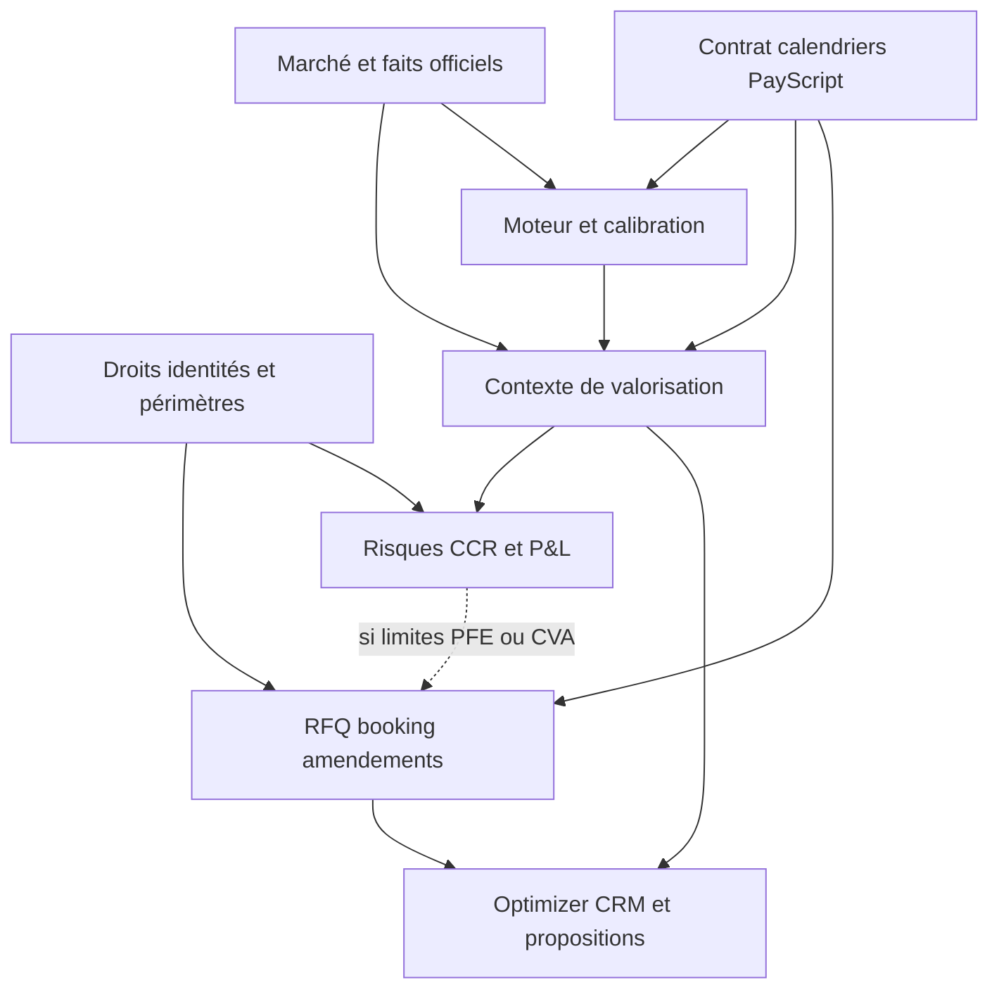

# Structura lot 0 du programme de remédiation

> Suivi du 20/10 après préparation : [C01 est implémenté et validé localement](REMEDIATION_C01_2026-10-20.md). Le présent rapport et sa baseline décrivent le lot 0 initial ; les statuts courants sont dans le registre.

Le lot 0 prépare les corrections des **modules 1 à 17**, sans modifier le code ni les données métier. Il conserve **132 constats d'audit** dans **27 chantiers**, avec un critère individuel pour chaque constat et **16 scénarios transversaux**. La remédiation applicative n'a pas commencé.

Date : **20 octobre 2026**, Europe/Berlin. Les constats proviennent des audits rendus le **19 octobre 2026** dans cette conversation ; leur priorité d'origine est conservée : **49 P1, 81 P2, 2 P3**. Ce sont des occurrences dans les audits, avec recoupements, et non 132 défauts indépendants. Le point métier M02-14 est traité comme décision D01, hors de ce comptage.

## Documents du lot

| Document | Usage |
|---|---|
| [Registre des anomalies](remediation-lot-0-2026-10-20/ANOMALY_REGISTER.md) | Retrouver chaque constat, sa priorité, son chantier, sa preuve antérieure, ses points d'entrée et le résultat attendu |
| [Dépendances et validation](remediation-lot-0-2026-10-20/DEPENDENCIES_AND_VALIDATION.md) | Préparer les 27 chantiers, dépendances communes et conditionnelles, 16 recettes transversales, 12 décisions et 16 limites de qualification |
| [Registre structuré](remediation-lot-0-2026-10-20/REGISTER.json) | Reprendre les identifiants et relations sans retraitement du Markdown |
| [Rapports sources](remediation-lot-0-2026-10-20/AUDIT_SOURCES.md) | Consulter les conclusions complètes des audits, leurs exemples et leurs réserves |
| [Baseline Git et empreintes](remediation-lot-0-2026-10-20/BASELINE.json) | Identifier l'état local au début du lot et contrôler la préservation des modifications préexistantes |
| [Contrôles de préparation](remediation-lot-0-2026-10-20/PREPARATION_CHECKS.json) | Vérifier comptages, liens, dépendances et absence de changement applicatif pendant le lot 0 |

## Référence et portée des preuves

- Dépôt : `C:/Users/admin/GitHub/structura`.
- Branche : `codex/hybrid-saas-foundation`.
- HEAD : `7dce3021a88feb4f0021ca3de8f3596277bc72a5`.
- Avant rédaction : **279 entrées** dans le statut Git usuel ; **291 entrées** lorsque les fichiers non suivis sont détaillés.
- Les modifications préexistantes sont conservées. Le HEAD seul ne décrit pas l'état local : le manifeste donne les empreintes SHA-256 des fichiers modifiés/non suivis présents.
- Cette baseline est celle du **20 octobre** ; elle ne prouve pas à elle seule l'identité de tous les fichiers avec l'état du 19 octobre. Les constats sont à revalider avant leur correction.
- Le manifeste n'ouvre aucune base métier et ne copie aucun contenu de données. Il ne contient pas les fichiers ignorés par Git ; il n'est ni une sauvegarde de l'application ni une sauvegarde des données.
- Les preuves **L** désignent une lecture/analyse décrite par l'audit ; **R**, une reproduction isolée rapportée par l'audit. Aucun constat n'est déclaré reproduit aujourd'hui, corrigé ou qualifié en production.
- Les contrôles du présent lot portent sur la documentation, ses références et la cohérence du registre. Aucun pytest, build, lancement de service, appel marché/IA, migration ou recalcul métier n'est requis par ce travail documentaire.

La présence d'un fichier de test dans la matrice n'atteste pas sa couverture. Les erreurs de fixture constatées dans certains audits, notamment les RFQ sans desk pilote et les montages limités par les stubs auth/migration, restent des réserves de preuve. Les totaux de tests des modules ne doivent pas être additionnés comme une couverture globale.

## Regroupement des constats

| Lot de remédiation | Chantiers principaux | Résultat visé |
|---|---|---|
| 1 | C01–C04, C27 | Droits, sessions, installations, identités stables, limites et périmètres explicites |
| 2 | C05–C07, C09–C10 | Contrat et calendrier exacts, versions protégées, saisies préservées et réponses UI contextualisées |
| 3 | C11–C13, C26 | Données datées et qualifiées, stockage sûr, registre officiel et suivi des traitements |
| 4 | C14–C17 | Axe temporel, funding/taux/corrélations, barrières et calibration qualifiés par usage |
| 5 | C18–C19, C21–C22 | Contexte de valorisation commun, archives, couverture des risques, CVA et P&L cohérents |
| 6 | C08, C23 | Commandes idempotentes, cotations versionnées, exécution et booking contrôlés |
| 7 | C20, C24–C25 | Recherche sauvegardée, CRM daté et monétaire, économie du roll et propositions exploitables |
| 8 | Tous sur leur périmètre | Reprise des données préparée, compatibilité et qualification opérationnelle de la chaîne |

Le lot principal est un classement de responsabilité. Il ne retarde pas une correction unitaire indépendante. Par exemple, le crash de sauvegarde Optimizer ou la clé de retry peuvent être corrigés tôt ; leur qualification finale doit conserver les prérequis de leur chaîne.

## Ordre de dépendance

Le graphe présente la qualification métier. La matrice détaillée distingue les prérequis communs, les conditions propres à un modèle/usage et les contrats d'interface ; elle ne transforme pas tous les liens en attente de développement.

## Première vague de revalidation

| Priorité d'engagement | Constats à reprendre | Invariant et interaction |
|---|---|---|
| 1 | M01-01 à M01-05, M16-01 | Les actions sensibles et projections CRM appliquent les permissions effectives ; préserver les calculs privés en ouvrant la reprise collective |
| 2 | M05-01, M06-05 | Aucune instruction ignorée ; événements exécutés dans l'ordre des dates ; base de tous les payoffs en aval |
| 3 | M11-01 à M11-04, M02-06 | Identité juridique valide, limites sur la position résultante et unicité du booking ; tests nominaux possibles avant requalification complète de la CVA |
| 4 | M04-01, M04-02, M09-01 | Une ancienne RFQ ne rétrograde pas Product et le canal de marché ne change pas le contrat |
| 5 | M03-01, M12-01, M12-02, M12-05, M13-01 | Finalité, autorité et atomicité du fixing ; le nouveau MtM et les risques consomment les faits officiels |
| 6 | M06-01 à M06-04, M13-02 | Taux/funding, covariance, barrières et horizon : corriger le moteur avant de généraliser son raccordement |
| 7 | M07-01 à M07-04 | Couverture de cible, contexte, refus de replis et qualification économique ; ne pas calibrer les erreurs du moteur |
| 8 | M15-01 à M15-05, M16-05 | Couverture réelle, scope Production, créance courte et fraîcheur ; ne pas annoncer une limite correcte sur une mesure non qualifiée |
| 9 | M14-01, M14-02, M17-01 à M17-03 | Après fondations : P&L au paiement, inputs complets et récupération finançable correctement définie |
| En parallèle si indépendant | M08-01, M04-06, M11-05, C10 | Corriger blocages, retries et erreurs d'interface avec leur preuve locale ; qualifier ensuite les raccordements |

Cette liste ordonne les premières reprises, sans abandonner les autres P1 du registre. Aucun contournement, désactivation de capacité ou changement de politique n'est appliqué par le lot 0.

## Interactions à préserver

1. **Funding** : corriger C15 avant de raccorder cette hypothèse dans les branches stochastiques de C18 et du scan. La transmettre plus largement avant correction propagerait le défaut.
2. **Calendriers** : vérifier ensemble ancre, jours ouvrés, paramètres par observation, ordre moteur et paiement. Une date ajoutée peut changer coupon, mémoire et rappel.
3. **Fixings** : la révision des faits invalide MtM, Greeks, P&L et CCR courants concernés ; les anciens runs demeurent des archives. terms_version ne suffit pas pour cette fraîcheur.
4. **Identité juridique** : amendement, ID, libellé descriptif, Product, set juridique et contrôle des limites évoluent atomiquement. Un renommage ne déplace pas l'exposition.
5. **Versions et idempotence** : distinguer une même intention répétée d'une nouvelle opération avec filiation ; la clé ne peut être renouvelée à chaque erreur réseau.
6. **Calibration** : grille, inputs actifs, courbes, modèle, réglages et contexte courant accompagnent le diagnostic ; un résultat hors contexte n'est pas réappliqué.
7. **Scopes et confidentialité** : la même origine Production/UAT/Demo et les mêmes droits gouvernent sélection, calcul, stockage, historique et projection. Les règles par mandat doivent aussi s'appliquer aux imports.
8. **Archives et exports** : conserver la version et les chiffres retenus ; une nouvelle méthode ou source crée un nouveau calcul/proposition. Aucun calendrier booké n'est régénéré silencieusement.
9. **Risque et exécution** : la sécurisation immédiate des limites nominales est indépendante d'une partie des modèles ; une décision fondée sur PFE/CVA attend la mesure qualifiée correspondante.

## Politique de validation

Chaque constat possède un identifiant **Mxx-yy**, un critère **V-Mxx-yy** et un chantier **Cxx**. Chaque scénario de chaîne possède un identifiant **T01 à T16**. Leur état initial est ouvert/à préparer.

Une clôture exige : reproduction ou preuve de disparition sur une baseline identifiée, correctif relu, validation ciblée, vérification des consommateurs, compatibilité/migration, réserves et date. Un HTTP200, une campagne terminée ou un test de fixture qui n'atteint pas son assertion n'est pas une preuve suffisante.

Un prérequis est satisfait par son contrat d'interface stabilisé et ses contrôles ciblés ; il n'exige pas que tout le chantier amont soit déjà Clos. Les scénarios partagés peuvent clôturer ensemble plusieurs chantiers après leur raccordement. Cette distinction permet les livraisons unitaires précoces et évite une attente circulaire de validation.

Les vérifications numériques utilisent une référence indépendante, des dates figées et des données synthétiques. Les tests déterministes, statistiques et de convergence ont des règles distinctes détaillées dans la matrice. Les tests métier et parcours ne sont pas écrits ou lancés dans ce lot documentaire.

Les modifications futures de code restent soumises aux règles du projet : tests ciblés depuis la racine, build depuis frontend après changement Vue, aucune suite backend complète ni commit/push sans instruction explicite.

## Historique et décisions

Les snapshots contractuels et anciens résultats sont conservés. Une évolution du moteur crée une version et un nouveau calcul ; une correction opérationnelle d'un Deal suit sa gouvernance. Le choix des seuils de fraîcheur, calendriers combinés, qualification modèle, droits de projection et gel commercial est explicite dans **D01 à D12**, sans approbation automatique.

Les politiques déjà arbitrées ne sont pas rouvertes artificiellement : fixing automatique courant, seconde signature des amendements désactivée par défaut et taux commun CCR de 3 % surchargeable. La convention de sens côté banque reste inchangée. Le P&L total et la variation de MtM gardent leurs définitions distinctes.

Les limites **Q01 à Q16** reprennent les domaines non qualifiés, le suivi du paiement, la frontière des preuves et les audits restant à faire. Les modules **18 AMC/FIFO, 19 Studies, 20 Documents, 21 IA/simulation et 22 Exploitation** demeurent hors de cet audit complet.

## Critères de sortie du lot 0

- Les constats numérotés des modules 1–17 sont tous rattachés une fois à un chantier principal ; priorités et sources sont conservées.
- Chaque constat possède un critère de validation concret et un statut qui ne revendique pas de remédiation.
- Les dépendances sont traçables et sans cycle, avec les conditions d'usage explicites.
- Les scénarios transversaux couvrent les 27 chantiers.
- Les décisions et limites sont distinctes des anomalies.
- Les références locales, identifiants et comptages sont contrôlés.
- La baseline est conservée et les fichiers applicatifs préexistants restent inchangés.
- La note est indexée dans docs/README.md.

**État : préparation documentaire du lot 0 ; aucune correction applicative, aucun test métier ni migration exécuté.**

